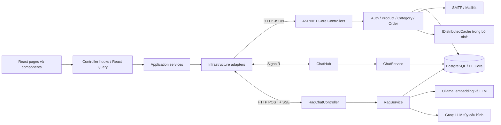
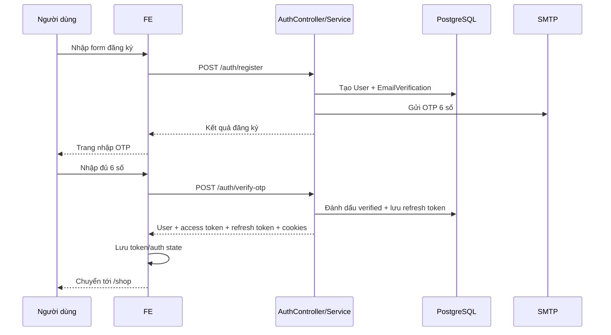
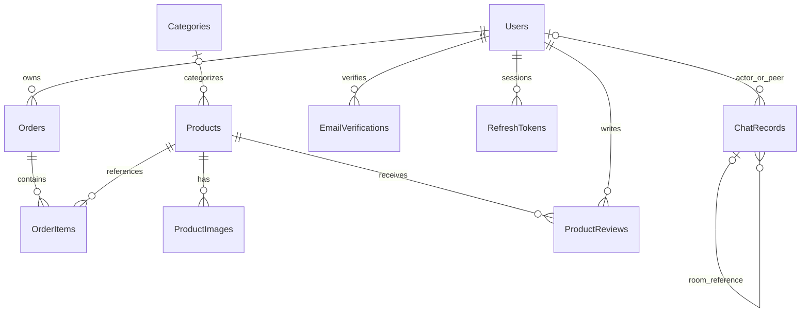

# MySystem / Onda Studio — Tài liệu mã nguồn FE và BE

Tài liệu này mô tả mã nguồn hiện có trong `frontend/src` và `System/src`, được đối chiếu ngày **13/10/2026**. Đây là bản hướng dẫn tổng hợp cho người mới tiếp nhận dự án: ứng dụng làm gì, mã nằm ở đâu, các phần giao tiếp như thế nào, cách cấu hình/chạy và những giới hạn cần biết.

Tên solution/backend là **MySystem**; một số thành phần giao diện dùng thương hiệu **Onda Studio**. Những mục ghi “hiện tại” mô tả hành vi đã có trong source, không phải cam kết rằng mọi luồng đã được kiểm thử trên môi trường triển khai.

## Mục lục

1. [Tổng quan và phạm vi chức năng](#tong-quan)
2. [Kiến trúc và công nghệ](#kien-truc)
3. [Cài đặt, chạy và cấu hình](#cai-dat)
4. [Frontend: cấu trúc và từng phần](#frontend)
5. [Backend: cấu trúc và từng phần](#backend)
6. [Luồng nghiệp vụ từ đầu đến cuối](#luong-nghiep-vu)
7. [Danh mục HTTP API](#http-api)
8. [Cơ sở dữ liệu và migration](#database)
9. [Chat trực tuyến và SignalR](#chat)
10. [Trợ lý AI, RAG và streaming](#ai)
11. [Kiểm tra, build và xử lý lỗi](#kiem-tra)
12. [Giới hạn hiện tại và hướng mở rộng](#gioi-han)
13. [Quy trình thêm chức năng](#phat-trien)
14. [Danh mục đầy đủ file trong hai thư mục src](#danh-muc-file)

<a id="tong-quan"></a>
## 1. Tổng quan và phạm vi chức năng

Ứng dụng kết hợp cửa hàng bán sản phẩm, quản lý sản phẩm và hai hình thức chat: người dùng trò chuyện với nhau qua SignalR và người dùng hỏi trợ lý AI về sản phẩm.

| Nhóm | Chức năng đã có | Giao diện / nơi sử dụng |
| --- | --- | --- |
| Khám phá cửa hàng | Trang chủ, danh mục đang hoạt động, sản phẩm mới, danh sách sản phẩm | `/`, `/shop` |
| Tìm kiếm sản phẩm | Tìm theo từ khóa, lọc danh mục, sắp xếp, phân trang | `/shop`, ô tìm kiếm navbar |
| Chi tiết sản phẩm | Tên, ảnh, giá, thông tin mô tả, tồn kho, chọn số lượng và thêm vào giỏ | `/product/:id` |
| Tài khoản | Đăng ký, đăng nhập bằng username/email, đăng xuất, khôi phục phiên, refresh token | `/register`, `/login` |
| Xác thực email | Gửi OTP, nhập 6 số, tự xác thực khi đủ số, gửi lại, đếm ngược | `/verify-otp?email=...` |
| Giỏ hàng | Thêm, gộp sản phẩm trùng, đổi số lượng, xóa, tổng tiền, lưu trên trình duyệt | Cart drawer trong layout |
| Đặt hàng | Nhập địa chỉ, tính phí giao hàng, tạo đơn từ giỏ, hiển thị mã đơn | `/checkout` |
| Đơn hàng cá nhân | Danh sách phân trang và chi tiết đơn thuộc tài khoản | `/my-orders`, `/order/:id` |
| Quản lý sản phẩm | Tạo, xem, sửa, xóa mềm, tìm kiếm/lọc, chọn danh mục | `/products` |
| Dashboard | Tổng số sản phẩm, chỉ số của tập sản phẩm tải về, sản phẩm gần đây, thông tin backend | `/dashboard` |
| Hồ sơ | Sửa họ tên, email, ngày sinh, số điện thoại; căn và thay avatar Cloudinary | `/profile` |
| Chat người dùng | Phòng chung, kết bạn, chat riêng, tạo/vào phòng bằng mã, lịch sử và online/offline | `/test-chat` |
| Tư vấn AI | Hỏi sản phẩm, nhận câu trả lời tăng dần và danh sách sản phẩm liên quan | Floating AI chat |
| Danh mục quản trị | Tạo/sửa/xóa danh mục | Có API và adapter, chưa có trang quản trị danh mục riêng |
| Quản trị đơn hàng | Xem mọi đơn và cập nhật trạng thái | Có API và query/mutation, chưa có trang quản trị đơn riêng |
| Đồng bộ AI | Tạo lại embedding sản phẩm | `POST /api/v1/RagAdmin/ReindexProducts` |
| Tiện ích giao diện | Theme sáng/tối, sidebar, toast, loading, phân trang, trang 404 | Các thành phần dùng chung |

### 1.1 Những chức năng không nên suy ra chỉ từ tên file

- `Checkout` hiện tạo đơn hàng; chưa có tích hợp cổng thanh toán, giao dịch thanh toán hay callback thanh toán.
- Có entity ảnh/đánh giá sản phẩm nhưng chưa có controller upload ảnh hoặc CRUD đánh giá cho khách hàng.
- Avatar chỉ được tải lên khi xác nhận ảnh đã căn và bấm lưu; BE tự xóa ảnh cũ theo tài khoản.
- Chat AI và chat người dùng là hai luồng độc lập. Lịch sử AI chưa được lưu vào `ChatRecords`.
- `ChangePassword` và `UpdateUser` tồn tại trong Auth service nhưng chưa được expose thành endpoint tương ứng trong AuthController.
- Tên `RagAdminController` không tự tạo quyền Admin: controller này hiện chưa có `[Authorize]`.
- `ProtectedRoute` chỉ kiểm tra đăng nhập, chưa kiểm tra role; API mới là nơi chặn các thao tác Admin đã được gắn policy.

<a id="kien-truc"></a>
## 2. Kiến trúc và công nghệ

### 2.1 Bố cục workspace

```text
My System/
├── README.md                    # Tài liệu tổng hợp này
├── frontend/                    # Dự án React độc lập
│   ├── src/
│   ├── public/
│   ├── scripts/
│   ├── tests/
│   ├── package.json
│   ├── package-lock.json
│   ├── vite.config.ts
│   ├── README.md
│   └── ARCHITECTURE.md
└── System/                      # Dự án .NET độc lập
    ├── MySystem.slnx
    ├── src/
    │   ├── MySystem.API/
    │   ├── MySystem.Service/
    │   └── MySystem.Repository/
    ├── scripts/check-boundaries.ps1
    ├── tests/ChatChecks/
    └── README.md
```

`node_modules`, `dist`, `bin`, `obj` là dependency/output có thể tạo lại, không phải nơi chỉnh nghiệp vụ. Các file `Migrations/*.cs` là source cần giữ vì mô tả lịch sử thay đổi database.

### 2.2 Sơ đồ giao tiếp



FE không import source C# và không truy cập PostgreSQL. BE không tham chiếu project frontend. Hợp đồng giữa hai bên là URL, JSON request/response, sự kiện SignalR và định dạng dữ liệu streaming.

### 2.3 Công nghệ theo manifest của dự án

| Phần | Thành phần | Vai trò |
| --- | --- | --- |
| FE | React 19, TypeScript 6 | Component và kiểu dữ liệu |
| FE | Vite 8, plugin React, Tailwind CSS 4 | Dev server, bundle, styles |
| FE | React Router 7 | Routing SPA và lazy-load trang |
| FE | TanStack React Query 5 | Cache dữ liệu server, query, mutation |
| FE | Zustand 5 | State auth, giỏ hàng và UI |
| FE | Axios | REST, cookie, bearer token, interceptor |
| FE | React Hook Form + Zod 3 | Form và validation phía trình duyệt |
| FE | `@microsoft/signalr` 10 | Kết nối realtime |
| FE | Lucide React | Icon |
| FE | Oxlint + Node test runner | Lint và kiểm tra source/hành vi/render |
| BE | .NET / ASP.NET Core 10 | Web API và SignalR |
| BE | Entity Framework Core 10.0.11 | Model, truy vấn, migration |
| BE | Npgsql EF provider 10.0.3 | Kết nối PostgreSQL |
| BE | JWT Bearer, BCrypt.Net-Next | Xác thực và hash mật khẩu |
| BE | MailKit | Gửi email qua SMTP STARTTLS |
| BE | FluentValidation, AutoMapper | Đã đăng ký hạ tầng; xem giới hạn thực tế bên dưới |
| BE | Swashbuckle | Swagger/OpenAPI |
| BE | Pgvector packages | Đã cấu hình provider; embedding hiện lưu JSONB và so khớp bằng C# |

Các version FE dùng `^`/`~` trong `package.json`, nên version cài thực tế phụ thuộc lockfile. Dùng `npm ci` để tái tạo dependency từ lockfile.

<a id="cai-dat"></a>
## 3. Cài đặt, chạy và cấu hình

### 3.1 Điều kiện cần

- .NET SDK 10 để build các project `net10.0` và solution `.slnx`.
- Node đáp ứng engine Vite đang cài: `^20.19.0 || >=22.12.0`; cần npm để cài dependency.
- PostgreSQL truy cập được bằng connection string cấu hình. Nếu chạy toàn bộ lịch sử migration từ đầu, server cần có extension pgvector khả dụng vì migration cũ từng tạo kiểu `vector(768)`, dù model mới nhất đã chuyển embedding sang JSONB.
- SMTP hợp lệ để đăng ký, gửi lại OTP và xác thực email hoạt động đầy đủ.
- Ollama có model embedding nếu dùng RAG. Model chat Ollama cần có khi không dùng Groq hoặc khi fallback.
- Groq là tùy chọn; Redis server **không phải điều kiện bắt buộc của cấu hình hiện tại** vì host đăng ký `AddDistributedMemoryCache()`.

Các lệnh dưới đây chạy từ thư mục gốc workspace, trừ đoạn có `Set-Location` rõ ràng.

### 3.2 Cấu hình frontend

```powershell
Set-Location frontend
npm ci
Copy-Item .env.example .env.local
npm run dev
```

Chỉ chạy `Copy-Item` khi chưa có cấu hình `.env.local` cần giữ. Nội dung tối thiểu:

```dotenv
VITE_API_BASE_URL=http://localhost:5000
```

- Giá trị mặc định trong `shared/config/environment.ts` là `http://localhost:5000`.
- Dấu `/` cuối API base URL được loại bỏ.
- `VITE_*` được đưa vào bundle công khai: không đặt mật khẩu database, SMTP hay Groq key ở frontend.
- `vite.config.ts` đặt port 5173; Vite có thể chọn port kế tiếp nếu port đó đã bận.
- FE gọi thẳng API base URL; hiện không có Vite proxy cho `/api`.

### 3.3 Cấu hình backend

Host đọc cấu hình bằng cơ chế cấu hình ASP.NET Core. File thường dùng nằm ở `System/src/MySystem.API/appsettings.json` và `appsettings.Development.json`; có thể dùng biến môi trường với `__` thay cho `:`.

Ví dụ dưới đây **chỉ là mẫu**, không chứa thông tin đăng nhập thật:

```json
{
  "ConnectionStrings": {
    "PostgresSql": "Host=localhost;Port=5432;Database=mysystem;Username=APP_DB_USER;Password=REPLACE_ME"
  },
  "JwtOption": {
    "Issuer": "MySystem",
    "Audience": "MySystem.Client",
    "AccessTokenKey": "REPLACE_WITH_A_RANDOM_SECRET_OF_AT_LEAST_32_BYTES",
    "AccessTokenExpirationMinutes": 120,
    "RefreshTokenExpirationDays": 7
  },
  "MailOption": {
    "Mail": "sender@example.com",
    "DisplayName": "MySystem",
    "Password": "REPLACE_ME",
    "Host": "smtp.example.com",
    "Port": 587
  },
  "Ollama": {
    "BaseUrl": "http://localhost:11434",
    "EmbeddingModel": "nomic-embed-text",
    "ChatModel": "qwen3:8b",
    "SimilarityThreshold": "0.5"
  },
  "Groq": {
    "BaseUrl": "https://api.groq.com",
    "Model": "llama-3.3-70b-versatile",
    "ApiKey": ""
  }
}
```

| Key | Nơi đọc / ý nghĩa | Mặc định trong code |
| --- | --- | --- |
| `ConnectionStrings:PostgresSql` | `Program.cs`, `AppDbContextFactory`; kết nối database | Bắt buộc, factory báo lỗi nếu thiếu |
| `JwtOption:Issuer` | Nơi phát hành JWT | Cần cấu hình |
| `JwtOption:Audience` | Bên nhận JWT | Cần cấu hình |
| `JwtOption:AccessTokenKey` | Ký/xác minh JWT HMAC SHA-256 | Cần cấu hình |
| `JwtOption:AccessTokenExpirationMinutes` | Thời hạn access token | 120 phút |
| `JwtOption:RefreshTokenExpirationDays` | Thời hạn refresh token và cookie refresh | 7 ngày |
| `MailOption:Mail`, `DisplayName` | Tài khoản gửi và tên hiển thị | Cần cấu hình |
| `MailOption:Host`, `Password`, `Port` | Máy chủ SMTP, mật khẩu, cổng | Port 587 |
| `Ollama:BaseUrl` | HTTP client embedding và chat | `http://localhost:11434` |
| `Ollama:EmbeddingModel` | Model tạo vector | `nomic-embed-text` |
| `Ollama:ChatModel` | Model trả lời/fallback | `qwen3:8b` |
| `Ollama:SimilarityThreshold` | Ngưỡng khoảng cách cosine được chấp nhận | 0.5 nếu parse thất bại |
| `Groq:BaseUrl` | HTTP client Groq | `https://api.groq.com` |
| `Groq:Model` | Model trả lời Groq | `llama-3.3-70b-versatile` |
| `Groq:ApiKey` | Không rỗng thì thử dùng Groq | Rỗng, dùng Ollama |

Ví dụ biến môi trường trong PowerShell:

```powershell
$env:ConnectionStrings__PostgresSql = 'Host=localhost;Database=mysystem;Username=APP_DB_USER;Password=REPLACE_ME'
$env:ASPNETCORE_ENVIRONMENT = 'Development'
```

`appsettings.Local.json` hoặc `.env` không tự được đọc chỉ vì có tên trong `.gitignore`; `Program.cs` hiện không đăng ký loader riêng cho các file này.

### 3.4 Tạo/cập nhật database rồi chạy API

```powershell
dotnet restore System/MySystem.slnx
dotnet build System/MySystem.slnx -c Release
dotnet ef database update --project System/src/MySystem.Repository --startup-project System/src/MySystem.API --configuration Release
dotnet run --project System/src/MySystem.API --launch-profile http
```

Nếu chưa có công cụ EF:

```powershell
dotnet tool install --global dotnet-ef --version 10.0.11
```

Nếu đã cài, dùng `dotnet tool update` thay cho `install` khi cần đồng bộ phiên bản. Không bắt buộc cập nhật tool chỉ để đọc tài liệu này.

| Địa chỉ phát triển | Chức năng |
| --- | --- |
| `http://localhost:5173` | Frontend |
| `http://localhost:5000` | API profile `http`, root redirect sang Swagger |
| `http://localhost:5000/swagger/index.html` | Swagger UI |
| `http://localhost:5000/swagger/v1/swagger.json` | Tài liệu OpenAPI |
| `https://localhost:5001` | HTTPS khi dùng profile `https` |
| `http://localhost:5000/hubs/chat` | SignalR hub |

**Thứ tự cho database mới:** áp migrations trước khi chạy API để EF ghi đầy đủ lịch sử. Startup hiện vẫn gọi `EnsureCreatedAsync`, cập nhật schema chat và seed; `EnsureCreated` không thay thế quy trình migration và không tạo lịch sử migration tương đương. Chi tiết tại mục database.

### 3.5 Bật phần AI

Cấu hình model phải khớp model đã có trên Ollama. Ví dụ tương ứng giá trị mặc định trong source:

```powershell
ollama pull nomic-embed-text
ollama pull qwen3:8b
```

Sau khi thêm sản phẩm hoặc thay đổi nội dung sản phẩm, gọi API reindex để tạo embedding. Việc tạo/sửa sản phẩm hiện không tự reindex. Dù dùng Groq cho câu trả lời, bước embedding vẫn gọi Ollama.

<a id="frontend"></a>
## 4. Frontend: cấu trúc và từng phần

Nguồn chính: [frontend/src](frontend/src), quy tắc lớp: [ARCHITECTURE.md](frontend/ARCHITECTURE.md).

### 4.1 Các lớp và chiều phụ thuộc

| Thư mục | Trách nhiệm | Không nên đặt ở đây |
| --- | --- | --- |
| `app/` | Ghép dependency, provider, router và khởi tạo ứng dụng | Quy tắc tính tiền hoặc xử lý database |
| `domain/models/` | Kiểu request/response, user, sản phẩm, đơn hàng, chat | React, Axios, localStorage |
| `domain/repositories/` | Interface mà application cần | Chi tiết HTTP/SignalR |
| `domain/policies/` | Quy tắc thuần cho giỏ hàng/phí vận chuyển | State component và hiệu ứng DOM |
| `application/services/` | Điều phối thao tác qua repository đã inject | Truy cập browser/HTTP trực tiếp |
| `application/validation/` | Zod schema cho form | Render JSX |
| `infrastructure/` | Adapter HTTP, session storage, SignalR, SSE | Bố cục giao diện |
| `presentation/` | Trang, controller hook, component, state, layout | Adapter gọi network trực tiếp |
| `shared/config/` | API URL, hằng số OTP, phí giao hàng, phân trang | State của feature |
| `shared/format/` | Định dạng tiền | Tính số tiền đơn ở backend |
| `styles/`, `index.css` | Theme, biến CSS, style toàn cục | Nghiệp vụ |

Chiều sử dụng chính:

```text
Page → controller hook → application service → repository interface
                                      ↑
app/configureServices.ts gắn infrastructure adapter vào service
```

Kiểm tra kiến trúc cho phép: domain chỉ phụ thuộc domain; application dùng domain và Zod; infrastructure dùng domain/shared; presentation dùng application/domain/shared/presentation; app là nơi ghép tất cả.

### 4.2 Khởi động FE

1. `main.tsx` import `app/configureServices.ts`, CSS, rồi render App trong `React.StrictMode`.
2. `configureServices.ts` gắn Auth, Product, Category, Order, Chat và Session repository.
3. `App.tsx` ghép `AppProviders` với `AppRoutes`.
4. `AppProviders.tsx` tạo React Query client và BrowserRouter; gọi `checkAuth()` để kiểm tra phiên.
5. `AppRoutes.tsx` lazy-load trang; Suspense dùng Spinner khi tải module.
6. `MainLayout.tsx` bao các trang chính bằng ChatProvider và ghép navbar, sidebar, footer, toast, cart drawer, floating AI chat.

React Query mặc định: `staleTime = 5 phút`, retry một lần, không tự refetch khi cửa sổ lấy lại focus. Đây là cache FE, khác cache sản phẩm ở BE.

### 4.3 Route và quyền thực tế

| Route | Page / feature | Guard thực tế |
| --- | --- | --- |
| `/` | `HomePage` / catalog | Public |
| `/shop` | `ShopPage` / catalog | Public |
| `/product/:id` | `ProductDetailPage` / catalog | Public |
| `/login` | `LoginPage` / auth | GuestRoute; đã login thì sang `/shop` |
| `/register` | `RegisterPage` / auth | GuestRoute |
| `/verify-otp` | `VerifyOTPPage` / auth | Không gắn guard; dùng query `email` |
| `/checkout` | `CheckoutPage` / checkout | ProtectedRoute |
| `/my-orders` | `MyOrdersPage` / orders | ProtectedRoute |
| `/order/:id` | `OrderDetailPage` / orders | ProtectedRoute; BE kiểm tra chủ đơn |
| `/dashboard` | `DashboardPage` / dashboard | ProtectedRoute, chưa có kiểm tra role |
| `/products` | `ProductsPage` / inventory | ProtectedRoute; API ghi dữ liệu cần Admin |
| `/profile` | `ProfilePage` / profile | ProtectedRoute |
| `/test-chat` | `ChatTestPage` / chat | Route public; SignalR cần tài khoản xác thực |
| `*` | `NotFoundPage` / errors | Trang 404 |

`ProtectedRoute` đợi `isInitializing`; chưa login thì chuyển `/login`. Comment “requires admin role” ở một số route không tương ứng với một phép kiểm tra Admin trong component guard.

### 4.4 Feature auth

- `pages/`: các điểm vào Login, Register, VerifyOTP.
- `hooks/useLoginPage.ts`, `useRegisterPage.ts`: form controller, resolver Zod, gọi mutation.
- `hooks/useVerifyOTPPage.ts`: đọc email từ URL, giữ OTP, đếm ngược, gửi lại, gọi xác thực tự động khi đủ 6 số.
- `components/`: chia form, view và `OtpInput` để nhập mã.
- `presentation/hooks/useAuthQueries.ts`: login/register/logout/update profile, cập nhật auth store, toast và điều hướng.

Validation FE:

| Form | Quy tắc |
| --- | --- |
| Login | Username/email và password không rỗng |
| Register | Username tối thiểu 3 ký tự; email đúng dạng; password tối thiểu 6; họ tên tối thiểu 2; phone tùy chọn; có field role |
| OTP | UI nhận 6 ký tự số qua component; server quyết định mã hợp lệ/hết hạn |

Bộ đếm OTP của FE là state cục bộ, khởi tạo 5 phút khi mở trang. Gửi lại đặt cooldown 5 phút và tăng số lần gửi lại cục bộ, tối đa 3. Không dùng các giá trị UI này làm bằng chứng xác thực ở BE.

### 4.5 Feature catalog

- `useHomePage`: tải 8 sản phẩm mới nhất và danh mục active.
- `HomeView` ghép `HomeHero`, `FeaturedProducts`, `HomeStory`, `HomePhilosophy`.
- `useShopPage`: đọc/ghi `category`, `search`, `page`, `sortBy`, `sortOrder` trên URL; đồng bộ ô tìm kiếm khi URL thay đổi.
- `ShopView` ghép danh mục, tìm kiếm/sắp xếp, card sản phẩm và phân trang; page size mặc định 8.
- `ShopProductCard` gọi controller để xem sản phẩm hoặc thêm một sản phẩm vào giỏ; chặn khi hết tồn kho.
- `useProductDetailPage`: tải theo route ID, quản lý số lượng, thêm vào giỏ và thông báo đã thêm.
- `ProductDetailView`, `ProductGallery`, `ProductInformation`: hiển thị dữ liệu sản phẩm; không có API upload trong nhóm này.

FE có loại filter giá trong adapter nhưng trang Shop hiện tập trung vào tìm kiếm, danh mục và sắp xếp; không mặc định coi mọi filter BE đều có control trên UI.

Một số nội dung mô tả giao diện như Material/Batch là text tĩnh trong component, chưa phải thuộc tính động lưu trong Product. API có thông tin rating tổng hợp nhưng chưa có luồng khách hàng gửi đánh giá ở trang chi tiết.

### 4.6 Feature inventory

`useProductsPage` quản lý ba modal: form tạo/sửa, xem chi tiết, xác nhận xóa. Search/category reset về trang 1, page size 8.

`useProductFormModal` dùng React Hook Form + `productSchema`, reset theo sản phẩm đang sửa và danh mục mặc định. Các component `ProductFormHeader`, `ProductFields`, `ProductFormModalView` chia nhỏ form; `ProductTable`, `ProductFilterBar`, `ProductDetailModal`, `DeleteConfirmModal` phục vụ danh sách và thao tác.

Validation FE: SKU ít nhất 3 ký tự, tên ít nhất 2, mô tả ít nhất 5, giá không âm, tồn kho là số nguyên không âm, danh mục bắt buộc, URL ảnh phải hợp lệ hoặc để trống. Form sửa không gửi SKU trong UpdateProductRequest. Ảnh được nhập dưới dạng URL.

Mutation sản phẩm gọi API, hiển thị toast và invalidation React Query. Invalidation FE không sửa được cache BE nếu phía server vẫn giữ dữ liệu cũ.

### 4.7 Giỏ hàng và checkout

- `domain/policies/cart.ts`: thêm/gộp item, đổi số lượng theo giới hạn stock, tính tổng số lượng và tiền.
- `cartStore.ts`: giữ danh sách item và trạng thái mở/đóng drawer; persist bằng key `mysystem-cart`.
- `CartDrawer.tsx` ghép controller `useCartDrawer` với `CartDrawerView` và `CartItems`.
- Giỏ chỉ tồn tại phía browser, chưa có cart API hoặc đồng bộ giữa thiết bị.
- `useCheckoutPage` lấy giỏ, khởi tạo tên người nhận từ user, giữ phone/address/note.
- Khi submit chỉ gửi `{ productId, quantity }` và thông tin giao hàng; không gửi giá làm căn cứ tính tiền.
- Thành công: giữ mã đơn để hiển thị, bật trạng thái thành công và xóa giỏ.
- Phí hiển thị: miễn phí khi subtotal từ 500.000 VND; còn lại 30.000 VND. Backend tính lại số tiền thật.

### 4.8 Đơn hàng, dashboard và profile

| Nhóm | Controller | View/components | Hành vi |
| --- | --- | --- | --- |
| Đơn cá nhân | `useMyOrdersPage` | `MyOrdersView` | Trang 10 đơn, đổi trang, danh sách rỗng/loading |
| Chi tiết đơn | `useOrderDetailPage` | `OrderDetailView`, `OrderHeader`, `OrderItems`, `OrderShippingDetails`, `OrderTotals` | Tải theo ID; hiển thị hàng, địa chỉ, trạng thái, tổng tiền |
| Dashboard | `useDashboardPage` | `DashboardView`, `InventorySummary`, `RecentProducts`, `BackendStatus` | Lấy tối đa 50 sản phẩm, tính active/low-stock/giá trị của tập đó |
| Hồ sơ | `useProfilePage` | `ProfileView`, `ProfileForm`, `MemberCard`, `AvatarCropDialog` | Sửa tên/email/phone/ngày sinh; căn và thay avatar; lưu hoặc bỏ thay đổi |

Dashboard dùng `totalCount` của API cho tổng số sản phẩm, nhưng active, stock thấp (`<=10`) và tổng giá trị chỉ tính từ các item đã tải. `BackendStatus` hiển thị thông tin endpoint, chưa phải health check độc lập.

Avatar chọn từ máy được căn trong khung vuông có lưới 3×3 và đường tròn nội tiếp, xuất PNG 512×512 rồi gửi multipart khi lưu. Object URL chỉ dùng xem trước và được thu hồi khi thay/hủy/unmount. Không có file mới thì FE không gọi API avatar. Xem [hợp đồng và xử lý lỗi](System/src/CLOUDINARY_RAG.md#hồ-sơ-và-thay-avatar).

### 4.9 Feature chat ở FE

- `ChatProvider`: đặt trong MainLayout để giữ phiên khi chuyển giữa các trang thuộc layout.
- `useChatSession`: kết nối SignalR theo tài khoản, nhận state/users/messages/room, reconnect và cleanup khi đổi tài khoản hoặc unmount.
- `useChatTestPage`: state form, tìm người dùng, lọc tin theo target, gửi/lời mời/phòng, chặn thao tác trùng, timer mã phòng.
- `ChatParticipants`: người dùng online/offline, nút kết bạn/chấp nhận/từ chối, tạo phòng và nhập mã.
- `ChatConversation`: lịch sử, nhãn online/offline, mã phòng còn hạn và ô gửi.
- `ChatTestView`: bố cục trang và trạng thái kết nối.
- `useFloatingAiChat`, `FloatingAiChat`, `FloatingAiChatView`: cửa sổ trợ lý AI riêng, không dùng hội thoại SignalR.

Chi tiết sự kiện và dữ liệu nằm tại mục Chat và AI.

### 4.10 State, query và lưu trữ trên browser

| Dữ liệu | Nơi quản lý | Lưu lâu dài? |
| --- | --- | --- |
| Access token | `sessionRepository` | `localStorage['token']` |
| User + isAuthenticated | `authStore` | Zustand persist `mysystem-auth` |
| isInitializing / trạng thái gửi OTP | `authStore` | State runtime |
| Items và trạng thái giỏ | `cartStore` | Zustand persist `mysystem-cart` |
| Theme | `uiStore` | `localStorage['onda_theme']` |
| Toast, sidebar | `uiStore` | Bộ nhớ; toast tự bỏ sau 4 giây |
| Dữ liệu API | React Query | Cache bộ nhớ |
| Lịch sử chat người dùng đang hiển thị | `useChatSession` | Bộ nhớ FE; nguồn bền vững là PostgreSQL |
| Lịch sử trợ lý AI | `useFloatingAiChat` | Chỉ bộ nhớ component |

`checkAuth()` kiểm tra token local trước; không có token thì coi là khách và không gọi `/me`, dù backend có khả năng nhận access-token cookie. Có token thì gọi profile, thất bại thì xóa token và chuyển state khách.

### 4.11 HTTP và session adapter

`axiosClient.ts` có `baseURL`, `withCredentials: true`, JSON Content-Type. Request tới auth public endpoint không gắn Authorization. Request khác gắn `Bearer` từ session; token còn dưới 30 phút thì thử refresh trước.

`createTokenRefresher.ts` dùng chung một Promise cho các request refresh đồng thời. Refresh bằng Axios riêng, timeout 10 giây, không đi qua chính interceptor để tránh đệ quy. Khi nhận 401, một request được retry tối đa một lần. Refresh thất bại xóa token.

`errors.ts` ưu tiên `detail`, rồi `message`, lỗi validation, rồi title không quá chung chung. Lỗi network được chuyển thành thông báo có API base URL.

Các adapter ánh xạ REST:

- `auth.service.ts`: đăng ký/login/OTP/refresh/logout/profile.
- `product.service.ts`: chuyển filter FE thành query lồng `Filters.*`, `Paginator.*`.
- `category.service.ts`: CRUD danh mục, `activeOnly`.
- `order.service.ts`: đơn của mình, chi tiết, tạo đơn, danh sách Admin, cập nhật trạng thái.
- `chatRepository.ts`: SignalR và fetch streaming AI; luồng fetch này không có interceptor refresh Axios.

### 4.12 Layout, component dùng chung và style

`MainLayout` dùng Outlet để lắp trang con. `Navbar` gọi `useNavbar` và render `presentation/components/NavbarView.tsx`; controller xử lý tìm kiếm, dropdown user, logout, giỏ hàng, theme. `Sidebar` có mục public và mục hiện khi đã login; việc hiện menu không phải kiểm tra role.

| Thành phần dùng chung | Vai trò |
| --- | --- |
| `Button`, `IconButton`, `LinkButton` | Nút và liên kết thống nhất |
| `Badge` | Nhãn trạng thái |
| `Loader` | Loading/spinner |
| `Pagination` | Điều khiển đổi trang |
| `StatCard` | Ô thống kê |
| `LiquidAvatar` | Avatar giao diện |
| `ColorModeToggle` | Đổi theme |
| `ToastContainer` | Hiển thị thông báo từ uiStore |

`styles/theme.css` chứa biến màu bề mặt/chữ/viền/nút cho sáng và tối. `index.css` ghép style toàn cục và các class dùng chung. Tên class như `nike-input`, `nike-title`, `onda-*` là quy ước giao diện hiện có, không phải module nghiệp vụ khác.

<a id="backend"></a>
## 5. Backend: cấu trúc và từng phần

Nguồn chính: [System/src](System/src). Solution có ba project với chiều tham chiếu:

```text
MySystem.API → MySystem.Service → MySystem.Repository
       └────────────────────────→ MySystem.Repository
```

Dự án có lớp tên `Repository`, nhưng các service hiện inject `AppDbContext` và truy vấn EF trực tiếp. Không có generic repository/unit-of-work abstraction riêng cần đi qua trước DbContext.

### 5.1 MySystem.API

| Thư mục/file | Trách nhiệm |
| --- | --- |
| `Program.cs` | Composition root, DI, DB provider, HTTP clients, pipeline, seed và map endpoints |
| `Controllers/AuthController.cs` | Auth, OTP, cookie token và profile |
| `Controllers/ProductController.cs` | REST sản phẩm, phân trang, thống kê, Admin CRUD |
| `Controllers/CategoryController.cs` | REST danh mục và Admin CRUD |
| `Controllers/OrderController.cs` | Đơn hàng, kiểm tra chủ đơn, Admin cập nhật trạng thái |
| `Controllers/RagChatController.cs` | Hỏi AI thông thường và streaming SSE |
| `Controllers/RagAdminController.cs` | Reindex embedding sản phẩm |
| `Extensions/JwtExtensions.cs` | JWT Bearer, token cookie/query của hub, authorization policies |
| `Extensions/SignalRExtensions.cs` | SignalR DI, CORS riêng cho hub, map `/hubs/chat` |
| `Extensions/RateLimitExtensions.cs` | Global limiter, policy login/api, response 429 |
| `Extensions/SwaggerExtensions.cs` | Swagger JSON/UI, redirect `/` |
| `Extensions/CookieAuthExtensions.cs` | Hạ tầng cookie authentication riêng còn trong source, không được Program gọi |
| `Filters/ValidationActionFilter.cs` | Tìm validator theo kiểu argument và base type, gom lỗi thành 422 |
| `Middleware/GlobalExceptionHandlerMiddleware.cs` | Log exception và chuẩn hóa JSON lỗi |
| `Infrastructure/DatabaseSeeder.cs` | Seed dữ liệu liên kết cho cửa hàng |
| `Infrastructure/ChatSchema.cs` | Giao dịch/advisory lock và chạy SQL chat nguyên văn |
| `Infrastructure/PersistentChat.sql` | Tạo bảng chat chung, chuyển dữ liệu từ năm bảng cũ |
| `Properties/launchSettings.json` | Profile HTTP/HTTPS và môi trường Development |
| `MySystem.API.csproj` | Dependency, project reference và nhúng SQL chat vào assembly |

### 5.2 Những gì Program.cs đăng ký

| Dịch vụ | Lifetime / cách đăng ký |
| --- | --- |
| `AppDbContext` | Scoped, Npgsql, vector mapping |
| Auth/Product/Category/Order service | Scoped |
| `IRagService` | Scoped |
| `IMailService` | Scoped |
| `IEmbeddingService` | Typed HttpClient |
| `RagChat.Ollama`, `RagChat.Groq` | Named HttpClient |
| `IJwtService`, `JwtOption`, `MailOption` | Singleton |
| `ICacheService` | Singleton `RedisCacheService` |
| `IDistributedCache` | DistributedMemoryCache trong process |
| `IChatService` | Singleton để giữ registry kết nối |
| Global exception middleware | Transient, triển khai IMiddleware |
| AutoMapper / validators | Scan assembly Service |

ChatService singleton không giữ một DbContext scoped lâu dài. Mỗi thao tác tạo scope mới qua `IServiceScopeFactory`, lấy DbContext và giải phóng sau thao tác.

### 5.3 Startup và middleware

Startup hiện thực hiện trước khi nhận request:

1. Tạo host từ config.
2. Cấu hình JSON camelCase và bỏ vòng tham chiếu.
3. Đăng ký controller, Swagger, database, auth, cache, mail, AI, SignalR.
4. Gọi `Database.EnsureCreatedAsync()`.
5. Gọi `ChatSchema.EnsureAsync()`.
6. Gọi `DatabaseSeeder.SeedAsync()`.
7. Nếu bước DB/seed lỗi, ghi warning rồi vẫn tiếp tục khởi động host.

Pipeline chính hiện theo thứ tự:

```text
GlobalExceptionHandlerMiddleware
→ Swagger
→ UseRouting
→ UseCors("AllowAll")
→ UseRateLimiter
→ UseRouting (đang có lần gọi thứ hai)
→ UseAuthentication
→ UseAuthorization
→ MapControllers + MapSignalRHubs
```

Rate limiter đứng trước authentication: không mặc định coi việc phân vùng theo `User.Identity.Name` đã nhận identity JWT; nhiều request thực tế sẽ phân vùng theo IP. Swagger đang bật cả ngoài Development vì điều kiện chứa `|| true`.

### 5.4 Auth service

[Service/Auth/Service.cs](System/src/MySystem.Service/Auth/Service.cs) xử lý:

- Kiểm tra username/email trùng trên user chưa bị xóa mềm.
- Hash password bằng BCrypt khi đăng ký.
- Tạo user và OTP trong transaction; gửi email rồi commit.
- Đăng nhập bằng username hoặc email, so khớp password bằng BCrypt.
- User chưa verify: gửi OTP mới và trả cờ `requiresEmailVerification`.
- User đã verify: phát access token và lưu refresh token.
- Gửi lại OTP trong giới hạn số lần.
- Verify OTP hợp lệ mới nhất, tăng số lần nhập sai, đánh dấu email đã verify.
- Xoay refresh token: thu hồi token cũ, tạo token mới.
- Đăng xuất: thu hồi refresh token nhận được.
- Đọc/cập nhật profile; kiểm tra email trùng với user khác.
- Có phương thức nội bộ đổi mật khẩu/cập nhật user nhưng chưa có endpoint tương ứng.

OTP phía BE:

| Quy tắc | Giá trị / hành vi |
| --- | --- |
| Độ dài | 6 số |
| Hạn | 5 phút |
| Gửi lại | Tối đa 3 record resend trong cửa sổ 5 phút |
| Nhập sai | Tối đa 3 lần trên record OTP đang xét |
| Record được xét | Mới nhất, chưa verified, chưa hết hạn |
| Lưu trữ | `EmailVerifications` |
| Sinh OTP | Hiện dùng `Random`, khác bộ sinh mật mã dùng cho mã phòng chat |

`UpdateProfile` cập nhật tên/email/phone/ngày sinh và UpdatedAt, giữ nguyên avatar. `AvatarService` dùng media service xóa ảnh cũ rồi tải ảnh mới, lưu URL/publicId. Hiện đổi email không tạo lại quy trình xác thực email mới.

### 5.5 Product service

`Product/Request.cs` chứa filter/paginator và DTO ghi dữ liệu; `Response.cs` chứa chi tiết, phân trang, thống kê và kết quả command; `IService.cs` là hợp đồng service.

- Danh sách bỏ các row `IsDeleted = true`, dùng AsNoTracking.
- Search tìm trong name, SKU, description, không phân biệt hoa/thường theo cách ToLower.
- Lọc ID list, category text, category ID, giá từ/đến và status list.
- Sort hỗ trợ `name`, `price`, `stock`, `createdat`, `updatedat`, `rating`; mặc định mới nhất.
- PageIndex nhỏ hơn 1 được đưa về 1; PageSize nhỏ hơn 1 về 10. Chưa có trần PageSize phía service sản phẩm.
- Chi tiết và danh sách có average rating/review count từ quan hệ Reviews.
- Tạo: SKU chưa trùng với sản phẩm chưa xóa; danh mục phải tồn tại, active và chưa xóa.
- Tạo tự chọn `Active` nếu stock > 0, ngược lại `OutOfStock`.
- Update không đổi SKU; cập nhật thông tin, danh mục và status request gửi lên.
- Delete là xóa mềm, không xóa row khỏi PostgreSQL.
- Statistics tính tổng/active/inactive/out-of-stock, giá cao nhất/thấp nhất/trung bình.

Cache BE: list 5 phút, detail 10 phút, statistics 5 phút. Tạo/sửa/xóa gọi invalidation detail/list/statistics, nhưng invalidation theo prefix hiện chưa xóa được toàn bộ key danh sách.

### 5.6 Category service

- Lấy danh sách chưa xóa, tùy chọn chỉ active; sort DisplayOrder rồi Name.
- Trả ProductCount là số sản phẩm active chưa xóa thuộc danh mục.
- Tạo/sửa slug, kiểm tra trùng với danh mục chưa xóa.
- Nếu request không có slug thì sinh từ tên; hàm chuyển dấu tiếng Việt hiện là các phép thay thế đơn giản, chưa phải chuẩn hóa đầy đủ mọi ký tự.
- Xóa mềm, nhưng chặn nếu còn bất kỳ sản phẩm chưa xóa nào trỏ tới danh mục.
- Sản phẩm giữ cả `CategoryId` và tên `Category` dạng text. Đổi tên danh mục không tự cập nhật tất cả text category trong sản phẩm.

### 5.7 Order service

- Danh sách Admin tìm theo mã đơn, tên người nhận, phone; lọc trạng thái.
- Danh sách của mình lọc UserId từ claim; có hỗ trợ Status ở service nhưng adapter `getMyOrders` hiện chỉ truyền phân trang.
- Phân trang: PageIndex tối thiểu 1, PageSize trong 1–100.
- Tạo đơn kiểm tra user, ít nhất một item, product tồn tại/chưa xóa, Active và đủ stock.
- Snapshot tên, SKU, ảnh, đơn giá vào OrderItem; đơn cũ không phải đọc lại giá hiện tại để tính tiền.
- Trừ stock; khi stock <= 0 chuyển product sang OutOfStock.
- Tính subtotal từ giá database; cộng phí giao hàng; lưu đơn và item bằng SaveChanges.
- Mã đơn dạng `ORD-yyyyMMdd-XXXX`, phần cuối lấy số ngẫu nhiên; database có unique index.
- Cập nhật status ghi các mốc xác nhận/gửi/giao/hủy tương ứng.
- Khi hủy, cộng lại số lượng sản phẩm và đổi OutOfStock về Active nếu cần.

Các trạng thái:

| Enum BE | Giá trị số | Ý nghĩa |
| --- | --- | --- |
| Pending | 0 | Chờ xác nhận |
| Confirmed | 1 | Đã xác nhận |
| Processing | 2 | Đang xử lý |
| Shipped | 3 | Đang giao |
| Delivered | 4 | Đã giao |
| Cancelled | 5 | Đã hủy |

Code hiện chưa có state machine quy định chuyển từ trạng thái nào sang trạng thái nào; gọi Cancelled nhiều lần có thể hoàn kho nhiều lần. Đây là giới hạn thực tế cần xử lý trước khi dựa vào quy trình vận hành đơn hàng nghiêm ngặt.

### 5.8 Những phần service dùng chung

| Nhóm | Nội dung |
| --- | --- |
| `JwtService` | Tạo JWT HMAC SHA-256, validate token, tạo token xác thực email dạng JWT còn trong service, tạo refresh token từ random bytes |
| `Mail` | `MailOption`, `MailContent`, `IMailService`, `MailService`; gửi HTML bằng MimeKit/MailKit qua STARTTLS |
| `MailTemplate` | Helper template còn trong source; Auth hiện tạo nội dung OTP trực tiếp trong Auth service |
| `Cache` | `ICacheService`, JSON serialize/deserialize và wrapper `IDistributedCache`, log lỗi và fallback |
| `Models` | BaseResponse, ApiResponse/ApiResponseFactory, PagedResult và envelope dùng chung |
| `Exceptions` | AppException và lỗi nghiệp vụ/auth/validation; middleware chuyển thành status code |
| `AssemblyReference.cs` | Marker assembly phục vụ scan đăng ký kiểu/service |
| `Embedding` | Gọi Ollama `/api/embed`, lấy vector đầu tiên |
| `Rag` | Index/search/context/LLM; chi tiết tại mục AI |
| `Chat` | Hub và dịch vụ realtime; chi tiết tại mục Chat |

### 5.9 Xác thực, cookie và quyền

Access token chứa NameIdentifier = UserId, Name = Username, Email, Role, FullName. Server kiểm tra issuer, audience, signing key, thời hạn; ClockSkew bằng 0.

JWT có thể được nhận qua Authorization header, access-token cookie, hoặc query `access_token` trên `/hubs/chat` để hỗ trợ WebSocket. Nên đọc `JwtExtensions.cs` nếu thay đổi thứ tự ưu tiên các nguồn token.

Cookie do AuthController đặt:

- `accessToken`, `refreshToken` đều HttpOnly.
- Hiện `Secure = false`, `SameSite = Lax`, phù hợp luồng local HTTP hơn là một cấu hình cross-site production hoàn chỉnh.
- Logout xóa cookie và thu hồi refresh token từ cookie; không có denylist access token.
- `CookieAuthExtensions` là một cơ chế cookie khác có tên `auth_cookie`, nhưng hiện không được đăng ký vào host.

UserRole entity hiện có `Customer`, `Admin`. JwtExtensions còn định nghĩa policy Staff/StaffOrAdmin, nhưng enum user hiện không có Staff; không coi đó là một chức năng nhân sự đã hoàn chỉnh.

### 5.10 Validation, response và rate limit

ValidationActionFilter tìm `IValidator<T>` của argument hoặc base type. Lỗi được chuyển thành `ValidationExceptionErrorV1` với tên field camelCase, kể cả đường dẫn `items[0].quantity`. Tuy nhiên source hiện không có implementation `AbstractValidator<T>` cho các request nghiệp vụ; filter và việc scan DI không tự sinh quy tắc validation.

Response thông thường có `success`, `message`, `data`, `traceId`; response tạo bằng factory còn có `timestampUtc`. Controller Category/Order dùng anonymous object nên không phải mọi endpoint đều có cùng tập field tuyệt đối.

Lỗi qua middleware có dạng:

```json
{
  "title": "Tên lỗi",
  "status": 400,
  "detail": "Mô tả lỗi",
  "messageCode": "ERROR_CODE",
  "errors": null,
  "traceId": "request-trace-id",
  "timestampUtc": "2026-10-13T00:00:00Z"
}
```

| Status | Nhóm lỗi |
| --- | --- |
| 400 | Nghiệp vụ/request không hợp lệ hoặc model binding |
| 401 | Thiếu/sai/hết hạn thông tin xác thực |
| 403 | Không đủ quyền, ví dụ xem đơn không thuộc mình |
| 404 | Tài nguyên không tồn tại |
| 422 | ValidationExceptionErrorV1 từ validator khi có đăng ký |
| 429 | Vượt rate limit |
| 500 | Exception không được phân loại, detail chung ở ngoài Development |

Model binding của `[ApiController]`, Forbid, SignalR HubException và SSE đã bắt đầu trả dữ liệu không nhất thiết dùng cùng một envelope middleware.

Rate limit được khai báo:

- Global: sliding window 250 request/giây, 5 segment, không xếp hàng.
- `login`: fixed window 5 request/phút theo IP, gắn vào endpoint login.
- `api`: fixed window 100 request/phút theo identity hoặc IP, chỉ gắn trên các action có attribute tương ứng.
- Bị từ chối trả HTTP 429 và `Retry-After: 60`.
- Đây là limiter HTTP; không thay thế một limiter riêng cho từng lần invoke gửi tin nhắn trên kết nối SignalR đang mở.

<a id="luong-nghiep-vu"></a>
## 6. Luồng nghiệp vụ từ đầu đến cuối

### 6.1 Đăng ký → OTP → phiên đăng nhập



Đăng nhập tài khoản chưa verify đi vào nhánh gửi OTP. Đăng nhập tài khoản đã verify trả token trực tiếp. FE hỗ trợ cả dữ liệu login trực tiếp và dạng có `loginData`.

### 6.2 Mua hàng

```text
Home/Shop/ProductDetail
→ addCartItem, cập nhật cartStore
→ CartDrawer
→ ProtectedRoute /checkout
→ POST /api/v1/order
→ BE đọc giá/tồn kho, tạo snapshot item, trừ stock, tính phí
→ FE hiện mã đơn và clearCart
→ /my-orders → /order/:id
```

Ví dụ subtotal 400.000 VND thì phí 30.000, tổng 430.000; subtotal 500.000 thì phí 0. Giá hiển thị trong giỏ có thể đã cũ; giá BE đọc khi đặt mới là giá dùng tạo đơn.

### 6.3 Quản trị sản phẩm

```text
/products → useProductsPage → ProductFormModal
→ Zod kiểm tra FE
→ create/update mutation → productService → HTTP adapter
→ ProductController kiểm tra AdminPolicy
→ Product service kiểm tra SKU/danh mục, ghi DB, yêu cầu xóa cache
→ FE invalidates products query và đóng modal khi thành công
```

Để AI biết nội dung sản phẩm mới, cần chạy reindex riêng. Xóa mềm sản phẩm khiến query nghiệp vụ bỏ qua row đó; không xóa dữ liệu snapshot trên OrderItem.

### 6.4 Vòng đời dữ liệu theo nơi lưu

| Thao tác | Browser | Backend memory | Database |
| --- | --- | --- | --- |
| Thêm giỏ | Persist giỏ | Không có giỏ BE | Chưa ghi đơn |
| Đăng nhập | Token + auth state | Không phải session server truyền thống | Refresh token |
| Gửi tin chat | Cập nhật từ event | Registry kết nối để phát tin | Ghi ChatRecords trước khi phát |
| Người dùng mất kết nối | UI chuyển trạng thái | Xóa connection tương ứng | Không xóa participant/message |
| Hỏi AI | State câu hỏi/câu trả lời | Request đang xử lý | Chỉ đọc sản phẩm/embedding; không lưu hội thoại AI |
| Reindex | Không phải dữ liệu UI riêng | Xử lý vector | Cập nhật Products.Embedding và EmbeddingContent |

<a id="http-api"></a>
## 7. Danh mục HTTP API

Base path là `/api/v1`. Bảng sau mô tả đúng attribute/controller hiện có. “Public” nghĩa là không có yêu cầu `[Authorize]` tại endpoint đó; vẫn có thể chịu global rate limit.

### 7.1 Auth — `/api/v1/auth`

| Method | Path | Quyền | Input chính | Kết quả |
| --- | --- | --- | --- | --- |
| POST | `/register` | Public | username, email, password, fullName, phoneNumber?, role? | Tạo user và gửi OTP |
| POST | `/login` | Public; policy login | usernameOrEmail, password | Token/user hoặc cờ cần verify |
| POST | `/send-otp` | Public | email | Gửi OTP mới theo giới hạn |
| POST | `/verify-otp` | Public | email, otpCode | Verify, tạo phiên, set cookies |
| POST | `/refresh-token` | Refresh token hợp lệ | refreshToken trong body hoặc cookie | Xoay token và set cookies mới |
| POST | `/logout` | Đăng nhập | Refresh token lấy từ cookie | Thu hồi refresh, xóa cookies |
| GET | `/me` | Đăng nhập | UserId từ claim | Profile |
| PUT | `/me` | Đăng nhập | fullName, email, phoneNumber?, dateOfBirth? | Profile đã cập nhật |
| PUT | `/me/avatar` | Đăng nhập | multipart: file | Xóa avatar cũ, tải ảnh mới và trả profile đã cập nhật |

Ví dụ body đăng ký:

```json
{
  "username": "demo.customer",
  "email": "demo.customer@example.com",
  "password": "REPLACE_WITH_YOUR_PASSWORD",
  "fullName": "Khách hàng thử nghiệm",
  "phoneNumber": "0900000000",
  "role": "Customer"
}
```

Service hiện nhận role từ request đăng ký; đây là điểm cần siết lại nếu tự đăng ký chỉ được cấp Customer.

### 7.2 Product — `/api/v1/product`

| Method | Path | Quyền | Chức năng |
| --- | --- | --- | --- |
| GET | `/` | Public; api limiter | Lọc, sắp xếp, phân trang |
| GET | `/{id:guid}` | Public; api limiter | Chi tiết sản phẩm |
| GET | `/statistics` | Public; api limiter | Thống kê sản phẩm |
| POST | `/` | Admin | Tạo sản phẩm |
| PUT | `/{id:guid}` | Admin | Sửa sản phẩm |
| DELETE | `/{id:guid}` | Admin | Xóa mềm |

Query BE sử dụng cấu trúc lồng, ví dụ:

```text
/api/v1/product?Filters.Search=ceramic&Filters.Category=Kitchen&Paginator.PageIndex=1&Paginator.PageSize=8&Paginator.SortBy=price&Paginator.IsDescending=false
```

| Query | Kiểu / ý nghĩa |
| --- | --- |
| `Filters.Ids` | Danh sách GUID |
| `Filters.Search` | Từ khóa |
| `Filters.Category` | Tên danh mục |
| `Filters.CategoryId` | GUID danh mục |
| `Filters.PriceFrom`, `Filters.PriceTo` | Cận giá |
| `Filters.Status` | Danh sách chuỗi trạng thái |
| `Paginator.PageIndex`, `PageSize` | Trang bắt đầu từ 1, kích thước trang |
| `Paginator.SortBy` | Tên, giá, tồn kho, thời điểm, rating theo các giá trị service hỗ trợ |
| `Paginator.IsDescending` | true/false |

Body tạo sản phẩm:

```json
{
  "sku": "SKU-DEMO-001",
  "name": "Sản phẩm mẫu",
  "description": "Mô tả sản phẩm mẫu",
  "price": 250000,
  "originalPrice": 300000,
  "stockQuantity": 10,
  "imageUrl": "https://example.com/product.jpg",
  "category": "Kitchen"
}
```

Có thể truyền `categoryId`; khi có ID, service ưu tiên ID để tìm danh mục active. Body update bỏ SKU và có thêm `status`; API không nhận hard-delete flag dù có DTO `DeleteProductRequest` trong source.

Response phân trang sản phẩm:

```json
{
  "success": true,
  "message": "Lấy dữ liệu thành công",
  "data": {
    "items": [],
    "pageIndex": 1,
    "pageSize": 8,
    "totalCount": 0,
    "totalPages": 0,
    "hasPreviousPage": false,
    "hasNextPage": false
  },
  "traceId": null
}
```

### 7.3 Category — `/api/v1/category`

| Method | Path | Quyền | Input / hành vi |
| --- | --- | --- | --- |
| GET | `/?activeOnly=true` | Public; api limiter | Danh mục active; mặc định activeOnly=false |
| GET | `/{id:guid}` | Public; api limiter | Chi tiết và số sản phẩm active |
| POST | `/` | Admin | name, slug?, description?, displayOrder, isActive |
| PUT | `/{id:guid}` | Admin | Cập nhật các field tương ứng |
| DELETE | `/{id:guid}` | Admin | Chỉ xóa mềm khi không còn sản phẩm chưa xóa |

### 7.4 Order — `/api/v1/order`

Controller yêu cầu đăng nhập. Chỉ GET tất cả và PATCH trạng thái yêu cầu thêm Admin.

| Method | Path | Quyền | Input / hành vi |
| --- | --- | --- | --- |
| GET | `/` | Admin; api limiter | Search, Status, PageIndex, PageSize |
| GET | `/my-orders` | Đăng nhập; api limiter | Đơn của user hiện tại, phân trang; BE hỗ trợ Status |
| GET | `/{id:guid}` | Chủ đơn hoặc Admin; api limiter | Chi tiết đơn, trả Forbid nếu không có quyền |
| POST | `/` | Đăng nhập; api limiter | Danh sách item và địa chỉ |
| PATCH | `/{id:guid}/status` | Admin | status, statusDescription? |

Body tạo đơn:

```json
{
  "items": [
    { "productId": "11111111-1111-1111-1111-111111111111", "quantity": 2 }
  ],
  "shippingName": "Người nhận",
  "shippingPhone": "0900000000",
  "shippingAddress": "Địa chỉ giao hàng",
  "shippingNote": "Gọi trước khi giao"
}
```

GUID trên là placeholder; phải thay bằng sản phẩm thật. Cấu hình JSON BE hiện chưa đăng ký `JsonStringEnumConverter`: status trên wire của OrderStatus theo cấu hình hiện tại là số 0–5, dù cột database lưu chuỗi và type FE đang khai báo chuỗi. Ví dụ PATCH tương ứng Confirmed:

```json
{ "status": 1, "statusDescription": "Đã xác nhận" }
```

Sự khác biệt enum giữa FE/BE được ghi trong mục giới hạn; không coi khai báo TypeScript là một phép chuyển đổi JSON runtime.

### 7.5 AI — RagChat và RagAdmin

| Method | URL | Quyền BE hiện tại | Kết quả |
| --- | --- | --- | --- |
| POST | `/api/v1/RagChat/Ask` | Public | Envelope chứa answer và relatedProducts |
| POST | `/api/v1/RagChat/AskStream` | Public | `text/event-stream` |
| POST | `/api/v1/RagAdmin/ReindexProducts` | Public, chưa gắn AdminPolicy | `{ indexed: số_sản_phẩm }` trong data |

Body hỏi:

```json
{ "question": "Tôi muốn tìm đồ dùng cho bàn làm việc" }
```

FE floating chat yêu cầu token trước khi gửi; đó là điều kiện UI/adapter, không phải `[Authorize]` của controller AI.

### 7.6 Endpoint ngoài REST nghiệp vụ

- `GET /` redirect Swagger.
- Swagger JSON/UI do middleware cung cấp.
- `/hubs/chat` là endpoint SignalR; gọi Hub method bằng SignalR client, không gọi chúng như URL REST.
- Chưa có endpoint health check chuyên biệt trong source.

<a id="database"></a>
## 8. Cơ sở dữ liệu và migration

### 8.1 Repository project

| Phần | Vai trò |
| --- | --- |
| `AppDbContext.cs` | DbSet nghiệp vụ, JSONB embedding, áp dụng entity configurations từ assembly |
| `AppDbContextFactory.cs` | Tạo context cho EF CLI mà không khởi động API/seed |
| `Abstractions/BaseEntity.cs` | Id, CreatedAt, UpdatedAt, IsDeleted cho các entity thương mại/auth |
| `Entities/` | Dữ liệu lưu trữ và navigation |
| `Configurations/` | Khóa, FK, index, độ dài, kiểu cột, delete behavior |
| `Migrations/` | Các bước thay đổi schema + model snapshot |
| `AssemblyReference.cs` | Marker để tìm assembly cấu hình |

`ChatRecord` không kế thừa BaseEntity: có CreatedAt riêng và không có IsDeleted/UpdatedAt. `AppDbContext` chưa khai báo property DbSet ChatRecords riêng nhưng truy cập được bằng `db.Set<ChatRecord>()`; configuration vẫn đưa entity vào EF model.

### 8.2 Các bảng hiện tại

| Bảng | Nội dung chính | Quan hệ |
| --- | --- | --- |
| `Users` | Username, email, PasswordHash, họ tên, role, phone, avatar, IsVerify | Cha của đơn, review, OTP, refresh token và actor/peer chat |
| `Categories` | Name, slug, description, display order, active | Một danh mục có nhiều sản phẩm |
| `Products` | SKU, name, description, price/original price, stock, ảnh chính, category text/ID, status, embedding | Thuộc danh mục; liên kết ảnh, review, order items |
| `ProductImages` | URL, alt text, thứ tự, isPrimary | Thuộc sản phẩm |
| `ProductReviews` | User, product, rating, title, comment, verified purchase, approved | Một cặp ProductId/UserId có unique index |
| `Orders` | OrderNumber, user, status, giao hàng, tổng tiền, phí, các mốc xử lý | Thuộc user; có nhiều item |
| `OrderItems` | Snapshot tên/SKU/ảnh/đơn giá, số lượng, discount | Thuộc đơn và trỏ sản phẩm |
| `EmailVerifications` | OTP, hạn, attempts, verified/resend timestamps | Thuộc user |
| `RefreshTokens` | Token, user, IP, user agent, device label, hạn, revoked, active | Thuộc user |
| `ChatRecords` | Mọi dữ liệu chat theo Type và JSONB | Trỏ User/Peer và tự tham chiếu Room |
| `__EFMigrationsHistory` | MigrationId, ProductVersion | Metadata do EF dùng khi áp migrations |

Giá trong entity dùng decimal; cấu hình tiền dùng precision phù hợp ở các bảng nghiệp vụ. Thời điểm ứng dụng ghi chủ yếu bằng UTC. Product.Embedding là `List<float>` được map sang JSONB; không có bảng embedding riêng trong model hiện tại.

Các entity dùng BaseEntity có xóa mềm bằng IsDeleted. Không có global query filter tự áp dụng cho mọi query; service phải lọc rõ. Unique index database trên một số cột vẫn có thể chặn giá trị từng được dùng trong row đã xóa mềm, dù kiểm tra nghiệp vụ chỉ xét row chưa xóa.

### 8.3 Sơ đồ quan hệ tổng quan



Sơ đồ này diễn đạt quan hệ nghiệp vụ chính. FK nullable và delete behavior cụ thể xem từng `*Configuration.cs`: các quan hệ bảo vệ lịch sử như đơn/user, item/product, chat dùng Restrict; một số quan hệ con như OTP/refresh token hoặc ảnh sản phẩm dùng Cascade.

### 8.4 Cấu trúc một bảng ChatRecords

| Field | Kiểu PostgreSQL / nullable | Ý nghĩa |
| --- | --- | --- |
| Id | uuid, bắt buộc | ID duy nhất của bản ghi |
| Type | varchar(24), bắt buộc | participant, room, membership, friendship, message |
| IdentityKey | varchar(80), nullable | Khóa định danh nghiệp vụ cho participant/membership/friendship |
| UserId | uuid, nullable | Người dùng chính: participant, member, requester hoặc sender |
| PeerId | uuid, nullable | Người nhận lời mời hoặc tin nhắn riêng |
| RoomId | uuid, nullable | FK tới một bản ghi phòng trong cùng bảng |
| Status | varchar(24), nullable | pending/accepted cho friendship |
| InviteCode | varchar(6), nullable | Mã tham gia của phòng |
| ExpiresAt | timestamp with time zone, nullable | Thời hạn mã phòng |
| CreatedAt | timestamp with time zone, bắt buộc | Thời điểm tạo bản ghi/gửi tin |
| SchemaVersion | integer, bắt buộc | Phiên bản payload, hiện 1 |
| Data | jsonb, bắt buộc | JSON object chứa dữ liệu riêng |

| Type | Cột được dùng | Data mẫu |
| --- | --- | --- |
| participant | UserId, IdentityKey = userId | `{}` |
| room | Id, InviteCode, ExpiresAt | `{ "name": "Phòng thiết kế" }` |
| membership | UserId, RoomId, IdentityKey = roomId:userId | `{}` |
| friendship | UserId=requester, PeerId=recipient, Status, IdentityKey cặp ID đã sort | `{}` |
| message | UserId=sender, PeerId hoặc RoomId, CreatedAt | `{ "text": "Xin chào" }` |

Tin phòng chung là message có PeerId và RoomId đều null. Tin riêng có PeerId; tin phòng có RoomId. JSON được serialize bằng System.Text.Json, bảo toàn Unicode/dấu ngoặc kép/backslash/xuống dòng; không tự ghép JSON bằng nối chuỗi từ nội dung user.

Mỗi tin nhắn và quan hệ thành viên là một row riêng. Không gom toàn bộ cuộc trò chuyện vào một mảng JSON tăng vô hạn.

### 8.5 Chỉ mục và ràng buộc chat

- Primary key Id.
- Unique index `(Type, IdentityKey)` để chống trùng participant, membership và cặp bạn bè.
- `(Type, UserId, CreatedAt, Id)` phục vụ truy vấn theo actor/thời gian.
- `(Type, PeerId, UserId, CreatedAt, Id)` phục vụ truy vấn tin riêng/quan hệ.
- `(Type, RoomId, CreatedAt, Id)` phục vụ lịch sử phòng.
- `(Type, InviteCode, ExpiresAt)` phục vụ tìm mã phòng còn hạn.
- Các index FK do model sinh cho UserId/PeerId/RoomId.
- Check Type chỉ nhận năm giá trị đã định nghĩa.
- Check Data phải là JSON object và SchemaVersion > 0.
- FK UserId/PeerId sang Users; RoomId tự tham chiếu ChatRecords, OnDelete Restrict.

Database chưa có check phân biệt field hợp lệ cho từng Type hoặc FK bắt buộc RoomId trỏ đúng Type=room; code dịch vụ phải giữ bất biến này. `Records(db, type)` lọc Type trước khi sử dụng payload. C# `PairKey` sort hai GUID dạng chuỗi để lời mời hai chiều có cùng identity.

### 8.6 Lịch sử migrations

| Migration | Mục đích được thể hiện trong lịch sử |
| --- | --- |
| `20260817070331_InitialCreate` | Schema nền ban đầu |
| `20260817075850_UpdateErrorAndResponseStructure` | Up/Down rỗng; giữ lại như một mốc lịch sử migration |
| `20260817113920_UpdateProductEmbedding` | Thay đổi embedding sản phẩm |
| `20260817181719_test` | Mở rộng các bảng thương mại; tên “test” vẫn là migration thật |
| `20260818041630_MergeEmbeddingIntoProduct` | Gộp embedding vào sản phẩm |
| `20260818042410_MigrateUserRoleToEnum` | Thay đổi biểu diễn role |
| `20260818043040_AddEmailVerificationAndRefreshToken` | Dữ liệu xác thực email/refresh |
| `20260818043315_UpdateUserRefreshTokenRelationship` | Quan hệ user–refresh token |
| `20260818045614_AddEmailVerificationOtp` | Cấu trúc OTP |
| `20261013041055_AddPersistentChat` | Mô hình chat cũ gồm năm bảng |
| `20261013054416_ConsolidateChatRecords` | Chuyển năm bảng chat thành ChatRecords |

`*.Designer.cs` lưu model theo thời điểm migration. `AppDbContextModelSnapshot.cs` là model mới nhất để EF so sánh lần sau. Việc tên bảng cũ còn trong migration/Designer không có nghĩa service vẫn đang dùng các bảng đó.

### 8.7 Hai cơ chế cập nhật đang tồn tại

**EF CLI:** đọc lịch sử migration, áp các migration còn thiếu, ghi `__EFMigrationsHistory`.

**API startup:** EnsureCreated → ChatSchema.EnsureAsync → DatabaseSeeder. ChatSchema chạy SQL nhúng trực tiếp, không đánh dấu migration đã áp dụng. Hai bước chat dùng SQL có khả năng chạy trên schema đã tạo nên sau đó EF có thể áp/ghi nhận migration chat, nhưng điều này không biến EnsureCreated thành công cụ baseline toàn bộ lịch sử cũ.

Với DB mới, chạy EF update trước API. Với DB đã có bảng từ EnsureCreated nhưng chưa có migration history, không xóa DB để chữa lỗi trùng bảng: cần đối chiếu schema và baseline đúng tình trạng thực tế. Không tự chèn tùy tiện toàn bộ migration history khi chưa xác minh schema.

Lệnh quản lý thường dùng:

```powershell
dotnet ef migrations list --project System/src/MySystem.Repository --startup-project System/src/MySystem.API --configuration Release
dotnet ef migrations has-pending-model-changes --project System/src/MySystem.Repository --startup-project System/src/MySystem.API --configuration Release
dotnet ef migrations add TenThayDoi --project System/src/MySystem.Repository --startup-project System/src/MySystem.API --configuration Release
dotnet ef migrations script --idempotent --project System/src/MySystem.Repository --startup-project System/src/MySystem.API --configuration Release --output migration-review.sql
dotnet ef database update --project System/src/MySystem.Repository --startup-project System/src/MySystem.API --configuration Release
```

Factory design-time đọc env `ConnectionStrings__PostgresSql` trước. Nếu không có, tìm thư mục API và đọc appsettings base + appsettings môi trường. Môi trường lấy từ `--environment`, `DOTNET_ENVIRONMENT`, `ASPNETCORE_ENVIRONMENT`, cuối cùng Development. Có thể truyền thư mục cụ thể:

```powershell
dotnet ef database update --project System/src/MySystem.Repository --startup-project System/src/MySystem.API --configuration Release -- --environment Development --content-root System/src/MySystem.API
```

Không có fallback âm thầm sang localhost/mysystem nữa. Factory chỉ tạo context, không chạy host, gửi email hay seed.

### 8.8 Migration gộp chat hoạt động thế nào

1. Lấy PostgreSQL advisory transaction lock.
2. Tạo ChatRecords và index nếu chưa có.
3. Nếu có bảng cũ: lock, copy room trước, rồi participant/membership/friendship/message.
4. Room ID, message ID, text, timestamp, user/peer, code/hạn và trạng thái bạn bè được giữ.
5. ID quan hệ cũ không có ID riêng được tạo xác định từ khóa quan hệ bằng MD5 cast UUID.
6. Record cũ không có thời gian tạo dùng thời gian migrate; room suy ra từ thời hạn mã trừ 5 phút.
7. Copy thành công mới drop các bảng cũ theo thứ tự quan hệ.
8. Xung đột dữ liệu làm transaction fail/rollback; không dùng DO NOTHING để bỏ qua dữ liệu trước khi drop.

`Down` của ConsolidateChatRecords bị vô hiệu hóa có chủ đích để tránh mất các payload JSON mở rộng. Muốn quay về mô hình cũ cần reverse data migration riêng hoặc phục hồi backup phù hợp.

SQL chứa literal `{}` cho JSONB; bootstrap dùng `DbCommand` chạy nguyên văn trong transaction. Không đưa lại đoạn script này vào đường gọi ExecuteSqlRaw định dạng chuỗi mà chưa xử lý dấu ngoặc.

### 8.9 Dữ liệu seed

DatabaseSeeder tạo/kiểm tra dữ liệu theo khóa tự nhiên để hạn chế trùng:

- Một tài khoản Admin và ba khách hàng mẫu.
- Năm danh mục: Kitchen, Living, Desk, Bath, Accessories.
- Mười hai sản phẩm mẫu có SKU, giá, tồn kho và ảnh URL.
- Ảnh sản phẩm cho các sản phẩm chưa có ảnh seed.
- Ba đơn mẫu và các dòng hàng liên kết.
- Sáu đánh giá mẫu.
- Có bước xử lý một số sản phẩm mock cũ theo SKU/danh mục.

Seed được gọi ở startup, hiện không bị giới hạn bằng cờ Development. Không coi dữ liệu này là dữ liệu kinh doanh thật. Tài liệu không chép mật khẩu seed hoặc các bí mật cấu hình; cần xem và kiểm soát quy trình tạo tài khoản khi triển khai.

<a id="chat"></a>
## 9. Chat trực tuyến và SignalR

### 9.1 Kết nối và danh tính

`ChatHub` có `[Authorize]`. UserId lấy từ claim NameIdentifier, không lấy tên do client tự khai. FE tạo connection với accessTokenFactory đọc access token hiện tại và bật automatic reconnect.

`useChatSession` tự kết nối khi có user trong MainLayout; không phải chỉ khi mở trang chat. Vì vậy người dùng có thể online khi đang xem Shop/Profile trong cùng layout. Rời layout hoặc logout sẽ cleanup connection. Tham gia kết nối tạo participant nếu chưa có, nên danh sách thể hiện các tài khoản từng tham gia phiên chat, kể cả chưa gửi tin.

### 9.2 Hub methods — client gọi server

| Method | Arguments | Quy tắc |
| --- | --- | --- |
| `Sync` | Không có | Lấy lại snapshot được phép xem |
| `SendMessage` | target, message | Lưu rồi phát; kiểm tra quyền theo target |
| `CreateRoom` | name | Tên 1–80 ký tự; tạo phòng và membership của người tạo |
| `JoinRoom` | code | 6 chữ số, còn hạn; tạo membership nếu chưa có |
| `RequestFriend` | targetId | Không tự kết bạn, target từng tham gia chat, chưa có quan hệ/lời mời |
| `AcceptFriend` | requesterId | Chỉ người nhận được chấp nhận lời mời pending |
| `DeclineFriend` | requesterId | Chỉ người nhận được từ chối lời mời pending |

Target:

```text
General                → phòng chung
user:<GUID tài khoản>  → chat riêng
room:<GUID phòng>      → phòng chat
```

Nội dung tin nhắn trim trước khi lưu, dài 1–4.000 ký tự. Chat riêng cần friendship accepted, không cần người nhận online. Phòng cần membership của người gửi.

### 9.3 Events — server gửi client

| Event | Payload | Khi gửi |
| --- | --- | --- |
| `ChatState` | users, rooms, friends, messages | Kết nối, Sync, thay đổi phòng/quan hệ cần refresh |
| `ParticipantsUpdated` | users có id, username, isOnline | Kết nối/ngắt kết nối |
| `MessageReceived` | Một tin nhắn đầy đủ | Sau khi ghi DB |
| `RoomOpened` | roomId | Tạo/vào phòng thành công, yêu cầu UI mở phòng |

Message contract FE:

```json
{
  "id": "message-guid",
  "senderId": "user-guid",
  "sender": "username",
  "receiverId": null,
  "roomId": "room-guid",
  "text": "Nội dung tin nhắn",
  "timestamp": "2026-10-13T00:00:00Z"
}
```

Room state có id/name/inviteCode/inviteExpiresAt. Friendship state có requesterId/recipientId/accepted; DB Status pending/accepted được chuyển thành boolean accepted khi gửi FE. Client không nhận nguyên row ChatRecords hay trường Data thô.

### 9.4 Lịch sử, offline và nhiều tab

- Server lưu message trước khi gửi event; người nhận offline vẫn nhận lại qua snapshot lần sau.
- Ngắt một connection không xóa participant hoặc lịch sử.
- Registry map `connectionId → userId`; một user có thể có nhiều tab/thiết bị.
- User chỉ offline khi không còn connection nào của tài khoản đó trong API instance.
- FE giữ cuộc hội thoại đang chọn khi đối phương offline.
- Online hiển thị chấm xanh và “Đang hoạt động”; offline hiển thị “Offline”. Không có tính thời gian offline/last-seen.
- Nếu mạng đứt đột ngột, trạng thái thay đổi khi SignalR phát hiện mất kết nối, không nhất thiết đúng tức thời lúc tắt mạng.
- Reconnect nhận lại state; FE loại tin live trùng theo message ID.
- Nếu start thất bại hoặc connection đóng hẳn, hook thử lại sau 5 giây.

Quyền đọc history: phòng chung cho người kết nối; tin riêng chỉ sender/receiver; tin phòng chỉ phòng user đã là thành viên. Thành viên mới hiện nhận cả lịch sử phòng đã có trước khi họ vào, vì query không lọc theo thời điểm join.

### 9.5 Phòng và mã mời

Mã được sinh bằng `RandomNumberGenerator.GetInt32(100000, 1000000)`, luôn là 6 chữ số không bắt đầu bằng 0. Server kiểm tra không trùng mã đang còn hạn trong process được serialize bằng gate.

Hạn là UTC tạo + 5 phút. UI đếm ngược chỉ để hiển thị; server vẫn kiểm tra ExpiresAt khi JoinRoom. Hết hạn chỉ vô hiệu mã, không xóa phòng/membership/lịch sử. Mỗi user bị giới hạn 10 lần thử mã trong 5 phút ở bộ nhớ service.

Hiện chưa có chức năng tạo lại mã cho phòng cũ, rời/xóa phòng, owner/moderator, đuổi thành viên, sửa/xóa tin, chặn người dùng, hủy kết bạn, đánh dấu đã đọc hoặc thông báo đẩy. Không suy ra các chức năng này từ việc có JSONB mở rộng.

### 9.6 Giới hạn triển khai chat

- Presence, rate limit join và lock xử lý hiện nằm trong một API process.
- SemaphoreSlim hiện serialize toàn bộ thao tác service, gồm cả một số truy vấn DB và gửi event.
- History snapshot đang tải toàn bộ tin được phép xem, chưa phân trang.
- Chỉ mục và row-per-message hỗ trợ phát triển keyset pagination, nhưng chưa triển khai endpoint phân trang đó.
- Chạy nhiều instance cần SignalR backplane, presence dùng chung và phối hợp cấp mã/quan hệ an toàn giữa các instance.
- Mã invite không có unique constraint theo “còn hạn” tại DB; lock in-process không bảo vệ các process khác.
- Đây là chat được lưu trên server, không có mã hóa đầu cuối trong code.

<a id="ai"></a>
## 10. Trợ lý AI, RAG và streaming

### 10.1 Phân biệt với chat trực tuyến

| Đặc điểm | Chat trực tuyến | Trợ lý AI |
| --- | --- | --- |
| Transport | SignalR | HTTP POST thường hoặc streaming SSE |
| Đối tượng trả lời | Người dùng khác | LLM Ollama/Groq |
| Dữ liệu hỗ trợ | ChatRecords | Products + EmbeddingContent/Embedding |
| Lịch sử bền vững | Có | Chưa có |
| Online/offline, kết bạn, mã phòng | Có | Không áp dụng |
| FE entry | `/test-chat` | FloatingAiChat trong MainLayout |

### 10.2 Reindex

`ReindexAllProducts` lấy toàn bộ sản phẩm chưa xóa, ghép tên/danh mục/giá/mô tả thành chuỗi, gọi EmbeddingService từng sản phẩm, lưu vector và chuỗi context vào Products rồi SaveChanges.

Nội dung tương tự:

```text
Tên: <tên>. Danh mục: <danh mục>. Giá: <giá>đ. Mô tả: <mô tả>.
```

Không có background job, incremental index hoặc queue; reindex chạy trong HTTP request. Nếu model embedding thay đổi, cần xây lại vector để tránh khác chiều/không cùng không gian vector.

### 10.3 Retrieval và câu trả lời

1. Tạo embedding câu hỏi qua Ollama `/api/embed`.
2. Lấy sản phẩm chưa xóa và có embedding từ PostgreSQL.
3. Tính cosine distance bằng C# trên danh sách đã tải vào memory.
4. Lọc distance <= threshold, sort tăng dần, lấy tối đa 5 sản phẩm.
5. Không có kết quả: trả câu báo không tìm thấy.
6. Có kết quả: dựng context từ EmbeddingContent và prompt yêu cầu trả lời ngắn gọn bằng tiếng Việt, không bịa sản phẩm.
7. Có Groq key thì thử Groq; lỗi ở luồng hỏi thường thì fallback Ollama. Streaming chỉ fallback khi Groq chưa bắt đầu stream thành công.
8. Trả câu trả lời và các sản phẩm phù hợp.

Search hiện không có điều kiện Status=Active hoặc StockQuantity>0, nên sản phẩm inactive/hết hàng nhưng có embedding vẫn có thể được đưa vào context. Ngưỡng hiện là **khoảng cách**: nhỏ hơn là gần hơn.

Dù có Pgvector packages, code không dùng SQL nearest-neighbor/HNSW cho bước tìm kiếm này. Việc tải toàn bộ embedding rồi tính trong C# sẽ là giới hạn khi danh mục lớn.

### 10.4 Định dạng streaming

RagChatController đặt Content-Type `text/event-stream`, Cache-Control no-cache và flush từng chunk:

```text
data: [PRODUCTS]:[{...sản phẩm...}]

data: Nội dung câu trả lời

```

FE dùng `fetch` POST, đọc `ReadableStream` bằng reader + TextDecoder. Không dùng EventSource vì request có body POST.

`streamParser.ts`:

- Giữ buffer khi một dòng bị chia giữa các chunk.
- Chỉ đọc dòng bắt đầu `data:`.
- `[PRODUCTS]:` được parse thành danh sách; JSON lỗi bị bỏ qua để tiếp tục nhận text.
- `[DONE]` được bỏ qua nếu có.
- `finish()` xử lý dòng cuối chưa có newline.
- Nội dung dòng hiện được trim; cần cải thiện framing nếu muốn bảo toàn tuyệt đối khoảng trắng/newline của output LLM.

`useFloatingAiChat` nối text vào message AI đang có và đặt products lên cùng message. AbortController hủy fetch khi unmount. Controller BE quan sát RequestAborted, nhưng cancellation chưa được truyền xuyên suốt mọi HTTP call trong RagService.

### 10.5 Giới hạn dữ liệu AI

- Chỉ gửi câu hỏi hiện tại, không gửi toàn bộ lịch sử thành context hội thoại nhiều lượt.
- Không lưu lịch sử AI xuống DB.
- Sản phẩm mới/sửa chưa tự cập nhật embedding.
- Reindex/Ask/AskStream hiện không có authorization attribute.
- AskResult và event products dùng Product entity thay vì một DTO tối giản; khi mở rộng cần kiểm soát field được trả về.
- Không có cơ chế retry/resume stream hoặc fallback giữa chừng sau khi đã nhận chunk đầu thành công từ Groq.

<a id="kiem-tra"></a>
## 11. Kiểm tra, build và xử lý lỗi

### 11.1 Frontend

Chạy trong `frontend`:

```powershell
npm run check:source
npm run check:architecture
npm run lint
npm test
npm run build
```

Hoặc gộp:

```powershell
npm run check
```

| Script/file | Kiểm tra gì |
| --- | --- |
| `scripts/check-source.cjs` | Import không thoát FE/src, import tồn tại, source/asset có tham chiếu từ entrypoint |
| `scripts/check-architecture.cjs` | Chiều phụ thuộc giữa các lớp, cấm browser/transport sai lớp |
| `oxlint src scripts tests` | Lint source và test |
| `tests/register.cjs` | Hỗ trợ load TypeScript/TSX cho test runner |
| `tests/policies.test.cjs` | Giỏ hàng, phí ship, validation, refresh token đồng thời/thất bại, stream parser |
| `tests/render.test.cjs` | Render trang với fixture store/query cache và các nhánh thiếu dữ liệu |
| `tests/chat.test.cjs` | Giữ chat offline, disable send khi mất kết nối, nhãn online, mã phòng hết hạn |
| `tsc -b && vite build` | Typecheck và tạo bundle `frontend/dist` |

Bộ kiểm tra FE hiện có 26 test. Render test dùng React server rendering với fixture, không phải kiểm thử tương tác browser đầy đủ. Không chứng minh email thật, CORS/cookie thật hoặc WebSocket thật hoạt động.

`npm run preview` phục vụ bundle đã build để xem thử; không thay thế cấu hình hosting production.

### 11.2 Backend

Từ root workspace:

```powershell
dotnet build System/MySystem.slnx -c Release
powershell -NoProfile -File System/scripts/check-boundaries.ps1
dotnet run --project System/tests/ChatChecks -c Release
```

`check-boundaries.ps1` kiểm tra solution/project reference nằm trong System/src và không trộn source FE vào BE.

`ChatChecks` là console kiểm tra có assertion, không phải project xUnit chạy bằng `dotnet test`. Nó dùng real ChatService, EF InMemory và fake SignalR clients ghi lại sự kiện. Hiện có 25 phép kiểm tra in PASS, gồm:

- Đọc connection string từ base config, override môi trường, env ưu tiên và báo lỗi khi thiếu cấu hình.
- Một tài khoản có nhiều tab; đóng một tab không làm offline cả tài khoản.
- Chặn nhắn riêng khi chưa kết bạn và chặn người khác chấp nhận lời mời.
- Gửi cho người offline, khôi phục sau reconnect.
- Cô lập tin riêng và tin phòng với user không có quyền.
- Participant không biến mất khi offline.
- Mã phòng 6 số, hạn 5 phút, server từ chối mã hết hạn.
- State được đọc lại khi tạo ChatService instance mới.
- Giới hạn độ dài tin nhắn và lịch sử phòng chung.
- Chỉ một bảng chat trong model, đủ năm Type, JSON object có version.
- Index identity, PairKey không phụ thuộc chiều gửi.
- JSON round-trip bảo toàn tiếng Việt, dấu nháy, backslash và newline.

Các test này không xác nhận SQL migration trên mọi phiên bản PostgreSQL, quan hệ FK/index thực thi của InMemory, mất mạng thật, nhiều server hay tải lớn. Tham khảo [tài liệu ChatChecks](System/tests/ChatChecks/README.md).

### 11.3 Ma trận kiểm thử thủ công

| Nhóm | Kịch bản cần thử khi thay đổi |
| --- | --- |
| Auth | Đăng ký mới/trùng, SMTP lỗi, login sai/đúng, user chưa verify, OTP sai/hết hạn/quá số lần |
| Session | Reload trang, token hết hạn, nhiều request cùng refresh, logout và đăng nhập tài khoản khác |
| Catalog | Không có kết quả, đổi category/search/sort, back/forward URL, sản phẩm bị xóa |
| Inventory | Admin CRUD, Customer bị chặn ghi, SKU trùng, category inactive, URL ảnh sai |
| Cart | Gộp item, giới hạn stock, giảm về 0, giỏ sau reload, cùng browser đổi user |
| Order | Giá/tồn kho thay đổi trước submit, hàng không Active, xem đơn user khác, hủy đơn lặp |
| Profile | Email trùng, bỏ thay đổi, avatar preview và reload |
| Chat | Hai tài khoản/hai tab, gửi offline, reconnect, accept/decline, mã hết hạn, nonmember không đọc/gửi phòng |
| AI | Chưa index, Ollama dừng, Groq lỗi, không có sản phẩm phù hợp, ngắt stream/unmount |
| Database | DB mới qua migrations, DB legacy, chạy migrate lần hai, rollback khi copy lỗi |

### 11.4 Các lỗi thường gặp

| Hiện tượng | Nơi kiểm tra / cách xử lý |
| --- | --- |
| FE không gọi được API | API có chạy không; VITE_API_BASE_URL; port; CORS; console/network |
| SignalR negotiate/WebSocket lỗi | Token; `/hubs/chat`; CORS SignalR; proxy có hỗ trợ WebSocket; TLS |
| Khách vào `/test-chat` nhưng không kết nối | Route hiện public nhưng hub có Authorize; cần đăng nhập |
| OTP không đến | MailOption, SMTP STARTTLS, quyền tài khoản SMTP và log MailService |
| Login liên tục quay về khách | Access token localStorage, cookie refresh, issuer/audience/key và `/me` |
| Refresh không chạy cross-site | Cookie SameSite/Secure và withCredentials; luồng fetch AI không dùng interceptor Axios |
| Dữ liệu list sản phẩm cũ sau sửa | Cache BE prefix chưa được invalidation toàn bộ, TTL list 5 phút |
| Tồn kho hiển thị chưa mới sau đặt | Order service chưa invalidation cache sản phẩm; FE cũng cần làm mới query liên quan |
| AI không tìm được sản phẩm | Có embedding chưa; threshold; model vector cùng chiều; dữ liệu chưa xóa |
| AI trả sai thông tin mới sửa | Chạy lại reindex; EmbeddingContent còn dữ liệu cũ |
| `Missing ConnectionStrings:PostgresSql` | Đặt env hoặc file config API; kiểm tra environment và content-root của EF factory |
| `password authentication failed` | User/password/host/database thực trong cấu hình, không dùng placeholder README |
| `relation ... already exists` khi migrate | Có thể DB từng tạo bằng EnsureCreated nhưng thiếu history; đối chiếu schema trước baseline |
| `extension vector is not available` khi migrate DB mới | Lịch sử migration có bước dùng pgvector; PostgreSQL server phải có extension này khả dụng, dù model cuối dùng JSONB |
| `FormatException` gần `{}` khi bootstrap chat | Dùng bản ChatSchema chạy SQL nguyên văn bằng DbCommand; không format literal JSON như placeholder |
| Không thể copy DLL khi build | API đang giữ file Debug/Release tương ứng; dừng phiên debug đó hoặc build cấu hình khác |
| EF tool cũ hơn runtime | Đối chiếu tool và EF package; warning version không phải lúc nào cũng là lỗi migration |
| Chat vẫn hiện schema cũ | Kiểm tra connection/database thật và `dotnet ef migrations list`; Designer/migration cũ vẫn giữ tên cũ là bình thường |
| Host chạy nhưng DB endpoint lỗi | Startup đang catch/log lỗi initialize; đọc warning DB/seed, không chỉ nhìn thông báo host listening |

Khi báo lỗi, cung cấp lệnh đã chạy, working directory, phần exception/status, traceId và environment; không dán mật khẩu, JWT hoặc connection string đầy đủ vào ticket/log công khai.

<a id="gioi-han"></a>
## 12. Giới hạn hiện tại và hướng mở rộng

Đây là các quan sát từ code, không phải phần đã được sửa trong đợt viết README. Tách rõ giúp người tiếp nhận không đánh đồng “có class/API” với “đã hoàn chỉnh chức năng”.

### 12.1 Quyền và dữ liệu tài khoản

| Quan sát | Hệ quả / phần cần hoàn thiện |
| --- | --- |
| Register nhận role do client gửi và parse vào UserRole | Cần ép Customer ở luồng tự đăng ký, tách cấp role thành thao tác quản trị |
| RagAdmin/RagChat chưa gắn Authorize | Cần quyết định quyền BE, quota và chính sách sử dụng tài nguyên AI |
| ProtectedRoute chưa kiểm tra role | FE không nên thể hiện route quản trị như đã được chặn theo Admin; BE vẫn phải kiểm tra độc lập |
| RefreshTokenHash thực tế chứa raw refresh token | Tên field không đồng nghĩa đã hash; cần thiết kế hash token lưu trữ |
| OTP hiện lưu trực tiếp và sinh bằng Random | Cần đánh giá cách sinh/lưu mã theo yêu cầu triển khai |
| Cookie Secure=false và CORS AllowAll chấp nhận mọi origin có credentials | Cần cấu hình domain/TLS/cookie cụ thể trước khi công khai hệ thống |
| Access token vẫn hợp lệ tới khi hết hạn sau logout | Chưa có thu hồi access token tức thời |
| Email thay đổi vẫn giữ IsVerify | Chưa có quy trình verify địa chỉ mới |
| Swagger luôn bật; seed luôn chạy | Cần tách chính sách môi trường và quy trình bootstrap production |

### 12.2 Hợp đồng FE/BE và validation

- OrderStatus BE là enum và JSON options chưa có converter chuỗi, trong khi FE chờ chuỗi. Cần thống nhất wire contract và thêm integration test; DB lưu enum bằng chuỗi không tự sửa serialization API.
- Auth/Product/Order/Category request chưa có bộ FluentValidation cụ thể dù hạ tầng đã đăng ký. Validation FE không ngăn request trực tiếp; đặc biệt cần kiểm tra quantity > 0, số tiền, độ dài và trạng thái hợp lệ ở BE.
- `GetMyOrders` adapter chỉ truyền PageIndex/PageSize, chưa chuyển toàn bộ filter type FE khai báo.
- API `ProductStatistics` có sẵn nhưng dashboard hiện tự tính nhiều chỉ số từ 50 sản phẩm tải về.
- Một số response có TimestampUtc, một số không; error từ model binding/rate limiter/Forbid có thể khác envelope chuẩn.
- Một số chuỗi tiếng Việt cũ trong FE đang bị lỗi encoding; README dùng UTF-8, không tự sửa toàn bộ nội dung UI.

### 12.3 Dữ liệu và cache thương mại

- `RemoveByPrefixAsync` hiện chỉ xóa key bằng đúng prefix, không quét key; danh sách cache có thể chờ TTL.
- Đặt/hủy đơn cập nhật product nhưng không gọi product cache invalidation.
- Chưa có optimistic concurrency/row lock dành riêng cho tồn kho; cần kiểm tra nhiều đơn đặt cùng sản phẩm đồng thời.
- Chưa chống lặp hoàn kho khi hủy hoặc ràng buộc luồng chuyển trạng thái đơn.
- Chưa có idempotency key cho tạo đơn và cơ chế retry khi mã đơn ngẫu nhiên trùng unique index.
- Unique index và soft delete cần được thiết kế đồng nhất nếu cho phép tái sử dụng SKU/email/slug.
- Review average/count hiện không lọc đầy đủ theo IsApproved/IsDeleted trong tất cả query; không mặc định coi chỉ review đã duyệt được tính.
- Có quan hệ ProductImages nhưng chi tiết sản phẩm REST hiện không tải/trả đầy đủ bộ gallery từ quan hệ này.
- Giỏ được lưu chung theo browser, chưa scope theo user; logout không đồng nghĩa tự xóa giỏ.
- Query cache chưa được phân vùng tài khoản/clear toàn bộ khi đổi user; cần kiểm tra dữ liệu cá nhân cũ trên cùng browser.

### 12.4 Khả năng mở rộng

| Phần | Hiện tại | Công việc cần có khi mở rộng |
| --- | --- | --- |
| Chat history | Snapshot toàn bộ | Phân trang theo CreatedAt/Id, tải từng cuộc trò chuyện |
| Chat presence | Dictionary trong một process | Shared presence, chính sách timeout và xử lý nhiều instance |
| SignalR delivery | Một host, không backplane | Backplane hoặc dịch vụ SignalR phù hợp |
| Mã phòng | Kiểm tra collision dưới khóa trong process | Phối hợp phân tán hoặc cơ chế cấp mã tại DB |
| ChatService | Semaphore cho toàn dịch vụ | Giảm phạm vi khóa, kiểm soát cạnh tranh tại DB theo nghiệp vụ |
| Product cache | Memory mỗi instance | Cache dùng chung và invalidation có thể kiểm chứng |
| RAG retrieval | Tải vector vào C# rồi tính | Truy vấn vector có index ở database khi dữ liệu lớn |
| Reindex | Đồng bộ trong HTTP request | Background job, incremental indexing, retry/trạng thái job |
| List products | Offset pagination, không trần PageSize | Giới hạn page size, đo query plan, keyset nếu phù hợp |
| Category count | Truy vấn count theo từng category | Gom query/group khi số category tăng |
| Lưu media | URL có sẵn, chưa upload | API upload, object storage, kiểm soát loại/kích thước file |
| Quan sát hệ thống | Log cơ bản, không health endpoint riêng | Health/readiness, metrics, tracing, đo độ trễ và lỗi |

Gộp chat vào một bảng giúp quản lý một mô hình record chung và mở rộng payload có version. Nó không tự tạo partitioning, phân trang, sharding, backplane hoặc loại bỏ tranh chấp khi nhiều server ghi cùng lúc.

### 12.5 Phần hiện chưa có UI/API hoàn chỉnh

Thanh toán online, quên/reset mật khẩu, đổi mật khẩu qua UI/API, upload ảnh, CRUD review khách hàng, danh sách quản trị user, trang quản trị danh mục/đơn riêng, wishlist bền vững, push notification, read receipt, đính kèm file chat, moderation phòng, thu hồi/sửa tin và lịch sử AI bền vững chưa được triển khai thành luồng đầy đủ trong source đang mô tả.

### 12.6 Build và dependency

Build trước đó có cảnh báo sẵn về AutoMapper 13.0.1, khác version EF Relational giữa một số reference, và tên migration `test`. Các warning này cần được theo dõi riêng; build pass không chứng minh mọi dependency và luồng nghiệp vụ đã sẵn sàng cho production. Tài liệu này không thay đổi version dependency hoặc sửa các vấn đề ngoài phạm vi tài liệu.

<a id="phat-trien"></a>
## 13. Quy trình thêm chức năng

### 13.1 Thêm chức năng frontend

1. Xác định request/response trong `domain/models`, tránh giả định shape từ giao diện.
2. Thêm method vào repository interface tương ứng.
3. Thêm application use case/service; nghiệp vụ thuần đặt trong policies khi phù hợp.
4. Triển khai adapter ở infrastructure và gắn tại `app/configureServices.ts`.
5. Thêm query/mutation ở presentation hooks; xác định query key và invalidation.
6. Viết controller hook feature để quản lý state và event.
7. Page ghép controller với view; chia component theo trách nhiệm hiển thị.
8. Thêm lazy route/guard; kiểm tra quyền thực tế ở BE.
9. Chạy check:source, architecture, lint, test và build theo mức thay đổi.

Không import Axios/fetch adapter từ JSX hoặc đưa quy tắc tính tiền vào component. Không cấu hình lại service registry trong render. Registry singleton và Zustand hiện phục vụ một SPA trong browser, chưa được thiết kế như container per-request cho SSR đa người dùng.

### 13.2 Thêm API/backend feature

1. Xác định hợp đồng request/response và quyền.
2. Thêm service interface/implementation vào nhóm nghiệp vụ.
3. Nếu có dữ liệu mới: entity, configuration và migration.
4. Đăng ký lifetime phù hợp trong Program hoặc extension.
5. Controller nhận input, lấy identity server-side, gọi service, trả response.
6. Bổ sung validation thực sự bằng validator/service rule, không chỉ đăng ký filter.
7. Nếu thay dữ liệu được cache: thiết kế invalidation cho mọi đường ghi.
8. Viết kiểm tra phân quyền, trường hợp lỗi và cạnh tranh nếu có.
9. Rà migration SQL trước khi áp DB có dữ liệu.
10. Cập nhật README/hợp đồng FE để hai bên cùng hiểu kiểu dữ liệu.

### 13.3 Mở rộng payload ChatRecords

Ví dụ muốn thêm metadata tin nhắn:

- Giữ mỗi message là một row.
- Thêm field JSON và chính sách SchemaVersion nếu thay đổi cấu trúc.
- Reader phải xử lý record phiên bản cũ rõ ràng.
- Field dùng thường xuyên trong WHERE/JOIN/SORT nên cân nhắc cột/index riêng.
- Cập nhật DTO SignalR và type FE; không gửi nguyên JSON database không kiểm soát.
- Kiểm tra history cũ, quyền đọc và reconnect sau thay đổi.
- Không dùng một field JSON mới để bỏ qua kiểm tra thành viên/kết bạn server-side.

### 13.4 Những tài liệu liên quan

- [README frontend](frontend/README.md): hướng dẫn riêng FE.
- [Quy tắc kiến trúc FE](frontend/ARCHITECTURE.md): chiều phụ thuộc và cách chia feature.
- [README backend](System/README.md): cách chạy BE độc lập.
- [README ChatChecks](System/tests/ChatChecks/README.md): schema chat, rollout và kiểm tra.
- [AppRoutes](frontend/src/app/routes/AppRoutes.tsx): nguồn chính xác về route FE.
- [Program.cs](System/src/MySystem.API/Program.cs): nguồn chính xác về DI/pipeline host.
- [AppDbContext](System/src/MySystem.Repository/AppDbContext.cs): model database.
- [ChatService](System/src/MySystem.Service/Chat/ChatService.cs): quyền và hành vi chat.

<a id="danh-muc-file"></a>
## 14. Danh mục đầy đủ file trong hai thư mục src

Danh mục dưới đây được tạo từ cây source khi viết tài liệu; bỏ qua `bin`/`obj`. File cấu hình cục bộ chỉ được liệt kê tên, không sao chép bí mật. Dùng mục này để tìm file; vai trò từng nhóm nằm ở các phần FE/BE phía trên.

Quy ước tên thường gặp:

| Tên | Vai trò trong source |
| --- | --- |
| `*Page.tsx` | Điểm vào route, ghép controller và view |
| `use*Page.ts`, `use*.ts` | Hook điều phối state, query và tương tác |
| `*View.tsx` | Bố cục render từ model/props |
| `*Repository.ts` trong domain | Hợp đồng truy cập dữ liệu/session |
| `*.service.ts` trong infrastructure | HTTP adapter |
| `*Service.ts` trong application | Service/use case FE |
| `Request.cs`, `Response.cs` | DTO theo nhóm nghiệp vụ BE |
| `IService.cs` | Interface service trong namespace nghiệp vụ tương ứng |
| `Service.cs` | Implementation nghiệp vụ trong namespace đó |
| `*Configuration.cs` | Mapping entity EF |
| Migration `.cs` | Up/Down thay đổi schema |
| Migration `.Designer.cs` | Model tại thời điểm migration |
| `AppDbContextModelSnapshot.cs` | Model EF mới nhất |

### 14.1 Frontend src

```text
frontend/src/
|-- app
|   |-- providers
|   |   \-- AppProviders.tsx
|   |-- routes
|   |   |-- AppRoutes.tsx
|   |   |-- GuestRoute.tsx
|   |   \-- ProtectedRoute.tsx
|   |-- App.tsx
|   \-- configureServices.ts
|-- application
|   |-- services
|   |   |-- authService.ts
|   |   |-- categoryService.ts
|   |   |-- chatService.ts
|   |   |-- orderService.ts
|   |   |-- productService.ts
|   |   \-- session.ts
|   \-- validation
|       |-- loginSchema.ts
|       |-- productSchema.ts
|       \-- registerSchema.ts
|-- domain
|   |-- models
|   |   |-- aiChat.ts
|   |   |-- api.ts
|   |   |-- auth.ts
|   |   |-- chat.ts
|   |   |-- order.ts
|   |   \-- product.ts
|   |-- policies
|   |   |-- cart.ts
|   |   \-- shipping.ts
|   \-- repositories
|       |-- AuthRepository.ts
|       |-- CategoryRepository.ts
|       |-- ChatRepository.ts
|       |-- OrderRepository.ts
|       |-- ProductRepository.ts
|       \-- SessionRepository.ts
|-- infrastructure
|   |-- auth
|   |   |-- createTokenRefresher.ts
|   |   |-- jwt.ts
|   |   \-- sessionRepository.ts
|   |-- chat
|   |   |-- chatRepository.ts
|   |   \-- streamParser.ts
|   |-- http
|   |   |-- axiosClient.ts
|   |   \-- errors.ts
|   \-- repositories
|       |-- auth.service.ts
|       |-- category.service.ts
|       |-- order.service.ts
|       \-- product.service.ts
|-- presentation
|   |-- components
|   |   \-- NavbarView.tsx
|   |-- features
|   |   |-- auth
|   |   |   |-- components
|   |   |   |   |-- LoginForm.tsx
|   |   |   |   |-- LoginView.tsx
|   |   |   |   |-- OtpInput.tsx
|   |   |   |   |-- RegisterForm.tsx
|   |   |   |   |-- RegisterView.tsx
|   |   |   |   \-- VerifyOTPView.tsx
|   |   |   |-- hooks
|   |   |   |   |-- useLoginPage.ts
|   |   |   |   |-- useRegisterPage.ts
|   |   |   |   \-- useVerifyOTPPage.ts
|   |   |   \-- pages
|   |   |       |-- LoginPage.tsx
|   |   |       |-- RegisterPage.tsx
|   |   |       \-- VerifyOTPPage.tsx
|   |   |-- cart
|   |   |   |-- components
|   |   |   |   |-- CartDrawer.tsx
|   |   |   |   |-- CartDrawerView.tsx
|   |   |   |   \-- CartItems.tsx
|   |   |   \-- hooks
|   |   |       \-- useCartDrawer.ts
|   |   |-- catalog
|   |   |   |-- components
|   |   |   |   |-- CategoryFilter.tsx
|   |   |   |   |-- FeaturedProducts.tsx
|   |   |   |   |-- HomeHero.tsx
|   |   |   |   |-- HomePhilosophy.tsx
|   |   |   |   |-- HomeStory.tsx
|   |   |   |   |-- HomeView.tsx
|   |   |   |   |-- ProductDetailView.tsx
|   |   |   |   |-- ProductGallery.tsx
|   |   |   |   |-- ProductInformation.tsx
|   |   |   |   |-- ShopProductCard.tsx
|   |   |   |   |-- ShopProductCardView.tsx
|   |   |   |   |-- ShopSearchAndSort.tsx
|   |   |   |   \-- ShopView.tsx
|   |   |   |-- config
|   |   |   |   \-- sortOptions.ts
|   |   |   |-- hooks
|   |   |   |   |-- useHomePage.ts
|   |   |   |   |-- useProductDetailPage.ts
|   |   |   |   |-- useShopPage.ts
|   |   |   |   \-- useShopProductCard.ts
|   |   |   \-- pages
|   |   |       |-- HomePage.tsx
|   |   |       |-- ProductDetailPage.tsx
|   |   |       \-- ShopPage.tsx
|   |   |-- chat
|   |   |   |-- components
|   |   |   |   |-- ChatConversation.tsx
|   |   |   |   |-- ChatParticipants.tsx
|   |   |   |   |-- ChatProvider.tsx
|   |   |   |   |-- ChatTestView.tsx
|   |   |   |   |-- FloatingAiChat.tsx
|   |   |   |   \-- FloatingAiChatView.tsx
|   |   |   |-- config
|   |   |   |   \-- chatStatus.ts
|   |   |   |-- hooks
|   |   |   |   |-- useChatSession.ts
|   |   |   |   |-- useChatTestPage.ts
|   |   |   |   \-- useFloatingAiChat.ts
|   |   |   \-- pages
|   |   |       \-- ChatTestPage.tsx
|   |   |-- checkout
|   |   |   |-- components
|   |   |   |   |-- CheckoutSummary.tsx
|   |   |   |   |-- CheckoutView.tsx
|   |   |   |   \-- ShippingForm.tsx
|   |   |   |-- config
|   |   |   |   \-- shippingFields.ts
|   |   |   |-- hooks
|   |   |   |   \-- useCheckoutPage.ts
|   |   |   \-- pages
|   |   |       \-- CheckoutPage.tsx
|   |   |-- dashboard
|   |   |   |-- components
|   |   |   |   |-- BackendStatus.tsx
|   |   |   |   |-- DashboardView.tsx
|   |   |   |   |-- InventorySummary.tsx
|   |   |   |   \-- RecentProducts.tsx
|   |   |   |-- hooks
|   |   |   |   \-- useDashboardPage.ts
|   |   |   \-- pages
|   |   |       \-- DashboardPage.tsx
|   |   |-- errors
|   |   |   \-- pages
|   |   |       \-- NotFoundPage.tsx
|   |   |-- inventory
|   |   |   |-- components
|   |   |   |   |-- DeleteConfirmModal.tsx
|   |   |   |   |-- ProductDetailModal.tsx
|   |   |   |   |-- ProductFields.tsx
|   |   |   |   |-- ProductFilterBar.tsx
|   |   |   |   |-- ProductFormHeader.tsx
|   |   |   |   |-- ProductFormModal.tsx
|   |   |   |   |-- ProductFormModalView.tsx
|   |   |   |   |-- ProductsView.tsx
|   |   |   |   \-- ProductTable.tsx
|   |   |   |-- hooks
|   |   |   |   |-- useProductFormModal.ts
|   |   |   |   \-- useProductsPage.ts
|   |   |   |-- pages
|   |   |   |   \-- ProductsPage.tsx
|   |   |   \-- types
|   |   |       \-- ProductFormModalProps.ts
|   |   |-- orders
|   |   |   |-- components
|   |   |   |   |-- MyOrdersView.tsx
|   |   |   |   |-- OrderDetailView.tsx
|   |   |   |   |-- OrderHeader.tsx
|   |   |   |   |-- OrderItems.tsx
|   |   |   |   |-- OrderShippingDetails.tsx
|   |   |   |   \-- OrderTotals.tsx
|   |   |   |-- config
|   |   |   |   \-- orderStatus.ts
|   |   |   |-- hooks
|   |   |   |   |-- useMyOrdersPage.ts
|   |   |   |   \-- useOrderDetailPage.ts
|   |   |   \-- pages
|   |   |       |-- MyOrdersPage.tsx
|   |   |       \-- OrderDetailPage.tsx
|   |   \-- profile
|   |       |-- components
|   |       |   |-- MemberCard.tsx
|   |       |   |-- ProfileForm.tsx
|   |       |   \-- ProfileView.tsx
|   |       |-- hooks
|   |       |   \-- useProfilePage.ts
|   |       \-- pages
|   |           \-- ProfilePage.tsx
|   |-- hooks
|   |   |-- useAuthQueries.ts
|   |   |-- useCategoryQueries.ts
|   |   |-- useNavbar.ts
|   |   |-- useOrderQueries.ts
|   |   \-- useProductQueries.ts
|   |-- layout
|   |   |-- Footer.tsx
|   |   |-- MainLayout.tsx
|   |   |-- Navbar.tsx
|   |   \-- Sidebar.tsx
|   |-- shared
|   |   \-- components
|   |       |-- Badge.tsx
|   |       |-- Button.tsx
|   |       |-- ColorModeToggle.tsx
|   |       |-- IconButton.tsx
|   |       |-- LinkButton.tsx
|   |       |-- LiquidAvatar.tsx
|   |       |-- Loader.tsx
|   |       |-- Pagination.tsx
|   |       |-- StatCard.tsx
|   |       \-- ToastContainer.tsx
|   \-- state
|       |-- authStore.ts
|       |-- cartStore.ts
|       \-- uiStore.ts
|-- shared
|   |-- config
|   |   |-- commerce.ts
|   |   |-- environment.ts
|   |   \-- otp.ts
|   \-- format
|       \-- currency.ts
|-- styles
|   \-- theme.css
|-- index.css
\-- main.tsx
```

### 14.2 Backend src

```text
System/src/
|-- .idea
|   \-- .idea.src.dir
|       \-- .idea
|           |-- .gitignore
|           |-- encodings.xml
|           |-- indexLayout.xml
|           |-- projectSettingsUpdater.xml
|           |-- vcs.xml
|           \-- workspace.xml
|-- MySystem.API
|   |-- Controllers
|   |   |-- AuthController.cs
|   |   |-- CategoryController.cs
|   |   |-- OrderController.cs
|   |   |-- ProductController.cs
|   |   |-- RagAdminController.cs
|   |   \-- RagChatController.cs
|   |-- Extensions
|   |   |-- CookieAuthExtensions.cs
|   |   |-- JwtExtensions.cs
|   |   |-- RateLimitExtensions.cs
|   |   |-- SignalRExtensions.cs
|   |   \-- SwaggerExtensions.cs
|   |-- Filters
|   |   \-- ValidationActionFilter.cs
|   |-- Infrastructure
|   |   |-- ChatSchema.cs
|   |   |-- DatabaseSeeder.cs
|   |   \-- PersistentChat.sql
|   |-- Middleware
|   |   \-- GlobalExceptionHandlerMiddleware.cs
|   |-- Properties
|   |   \-- launchSettings.json
|   |-- appsettings.Development.json
|   |-- appsettings.json
|   |-- MySystem.API.csproj
|   \-- Program.cs
|-- MySystem.Repository
|   |-- .claude
|   |   \-- settings.local.json
|   |-- Abstractions
|   |   \-- BaseEntity.cs
|   |-- Configurations
|   |   |-- CategoryConfiguration.cs
|   |   |-- ChatConfiguration.cs
|   |   |-- EmailVerificationConfiguration.cs
|   |   |-- OrderConfiguration.cs
|   |   |-- OrderItemConfiguration.cs
|   |   |-- ProductConfiguration.cs
|   |   |-- ProductImageConfiguration.cs
|   |   |-- ProductReviewConfiguration.cs
|   |   |-- RefreshTokenConfiguration.cs
|   |   \-- UserConfiguration.cs
|   |-- Entities
|   |   |-- Category.cs
|   |   |-- Chat.cs
|   |   |-- EmailVerification.cs
|   |   |-- Order.cs
|   |   |-- OrderItem.cs
|   |   |-- Product.cs
|   |   |-- ProductImage.cs
|   |   |-- ProductReview.cs
|   |   |-- RefreshToken.cs
|   |   |-- User.cs
|   |   \-- UserRole.cs
|   |-- Migrations
|   |   |-- 20260817070331_InitialCreate.cs
|   |   |-- 20260817070331_InitialCreate.Designer.cs
|   |   |-- 20260817075850_UpdateErrorAndResponseStructure.cs
|   |   |-- 20260817075850_UpdateErrorAndResponseStructure.Designer.cs
|   |   |-- 20260817113920_UpdateProductEmbedding.cs
|   |   |-- 20260817113920_UpdateProductEmbedding.Designer.cs
|   |   |-- 20260817181719_test.cs
|   |   |-- 20260817181719_test.Designer.cs
|   |   |-- 20260818041630_MergeEmbeddingIntoProduct.cs
|   |   |-- 20260818041630_MergeEmbeddingIntoProduct.Designer.cs
|   |   |-- 20260818042410_MigrateUserRoleToEnum.cs
|   |   |-- 20260818042410_MigrateUserRoleToEnum.Designer.cs
|   |   |-- 20260818043040_AddEmailVerificationAndRefreshToken.cs
|   |   |-- 20260818043040_AddEmailVerificationAndRefreshToken.Designer.cs
|   |   |-- 20260818043315_UpdateUserRefreshTokenRelationship.cs
|   |   |-- 20260818043315_UpdateUserRefreshTokenRelationship.Designer.cs
|   |   |-- 20260818045614_AddEmailVerificationOtp.cs
|   |   |-- 20260818045614_AddEmailVerificationOtp.Designer.cs
|   |   |-- 20261013041055_AddPersistentChat.cs
|   |   |-- 20261013041055_AddPersistentChat.Designer.cs
|   |   |-- 20261013054416_ConsolidateChatRecords.cs
|   |   |-- 20261013054416_ConsolidateChatRecords.Designer.cs
|   |   \-- AppDbContextModelSnapshot.cs
|   |-- AppDbContext.cs
|   |-- AppDbContextFactory.cs
|   |-- AssemblyReference.cs
|   \-- MySystem.Repository.csproj
\-- MySystem.Service
    |-- Auth
    |   |-- IService.cs
    |   |-- Request.cs
    |   |-- Response.cs
    |   \-- Service.cs
    |-- Cache
    |   |-- ICacheService.cs
    |   \-- RedisCacheService.cs
    |-- Category
    |   |-- IService.cs
    |   |-- Request.cs
    |   |-- Response.cs
    |   \-- Service.cs
    |-- Chat
    |   |-- ChatHub.cs
    |   |-- ChatService.cs
    |   \-- IChatService.cs
    |-- Embedding
    |   |-- EmbeddingService.cs
    |   \-- IEmbeddingService.cs
    |-- Exceptions
    |   |-- AppException.cs
    |   |-- AuthExceptions.cs
    |   |-- ValidationError.cs
    |   \-- ValidationExceptionErrorV1.cs
    |-- JwtService
    |   |-- IJwtService.cs
    |   |-- JwtOption.cs
    |   \-- JwtService.cs
    |-- Mail
    |   |-- IMailService.cs
    |   |-- MailContent.cs
    |   |-- MailOption.cs
    |   |-- MailService.cs
    |   \-- MailTemplate.cs
    |-- Models
    |   |-- ApiResponse.cs
    |   |-- BaseResponse.cs
    |   \-- PagedResult.cs
    |-- Order
    |   |-- IService.cs
    |   |-- Request.cs
    |   |-- Response.cs
    |   \-- Service.cs
    |-- Product
    |   |-- IService.cs
    |   |-- Request.cs
    |   |-- Response.cs
    |   \-- Service.cs
    |-- Rag
    |   |-- IRagService.cs
    |   |-- RagService.cs
    |   |-- Request.cs
    |   \-- Response.cs
    |-- AssemblyReference.cs
    \-- MySystem.Service.csproj
```
